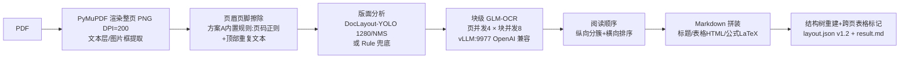
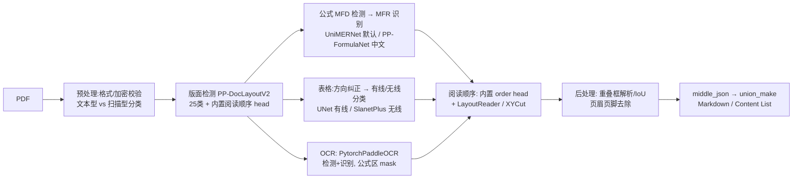

# MinerU 链路调研与 HansonDOC RAG 解析管线对比

> 结论先行：我们当前是“**轻量自建管线 + 统一 GLM-OCR 大模型识别**”；
> MinerU 是“**多后端可插拔框架**”，其中 pipeline 后端是“**多专用小模型串行组合**”，2.5 起增加“**VLM 端到端**”。
> 两者在“PDF→版面→识别→阅读顺序→Markdown”主链路上一致，差异集中在识别层技术路线与工程化深度。

## 1. 我们当前 OCR/解析管线（以源码为准）

入口：`document_service.run_parse_task` → `parsekit.pipeline.parse_pdf`（[pipeline.py](/home/grainuser/hansonDoc_RAG/backend/app/services/parsekit/pipeline.py)）。

各环节实现文件：

| 阶段 | 实现 | 关键细节 |
|------|------|----------|
| 渲染 | [render.py](/home/grainuser/hansonDoc_RAG/backend/app/services/parsekit/render.py) | PyMuPDF 渲染 PNG（DPI=200）、文本层与图片框提取；单页失败可 partial |
| 页眉页脚 | [header_footer.py](/home/grainuser/hansonDoc_RAG/backend/app/services/parsekit/header_footer.py) | 方案 A 内置规则（U3 择优胜出）：页码正则 + 跨页重复顶部文本；封面保留 |
| 版面 | [layout.py](/home/grainuser/hansonDoc_RAG/backend/app/services/parsekit/layout.py) | DocLayoutEngine：`doclayout_yolo_docstructbench_imgsz1280_2501.pt`（SHA256 锁定），letterbox 1280 + one2one + NMS，LABEL_MAP 11 类映射；RuleLayoutEngine 兜底 |
| OCR | [ocr.py](/home/grainuser/hansonDoc_RAG/backend/app/services/parsekit/ocr.py) + [glmocr.py](/home/grainuser/hansonDoc_RAG/backend/app/services/ocr_backend/glmocr.py) | 仅 doclayout 引擎启用；页 4 × 块 8 并发；8 类提示词（title/text/table/formula/caption/footnote/aside）；图块最长边 ≤2048 等比缩放；重试 2 次；U13 不回退 |
| 阅读顺序 | [reading_order.py](/home/grainuser/hansonDoc_RAG/backend/app/services/parsekit/reading_order.py) | 纵向重叠分簇 + 簇内横向排序（PDF-Extract-Kit 思路） |
| 拼装 | [assemble.py](/home/grainuser/hansonDoc_RAG/backend/app/services/parsekit/assemble.py) | 标题 `#`、表格 HTML、公式 `$$LaTeX$$`、图片/公式占位注释、caption 斜体、脚注引用 |
| 重建 | [rebuild.py](/home/grainuser/hansonDoc_RAG/backend/app/services/parsekit/rebuild.py) | 标题层级栈式重建、图文/表注关联、U8 跨页表格仅标记不合并 |
| 任务/状态 | [document_service.py](/home/grainuser/hansonDoc_RAG/backend/app/services/document_service.py) | queued→rendering→layout→ocr→rebuild→completed；按页进度落库；partial 策略 |

关键配置（[config.py](/home/grainuser/hansonDoc_RAG/backend/app/core/config.py)）：`PARSEKIT_LAYOUT_ENGINE=doclayout`、`PARSEKIT_OCR_ENABLED=true`、`GLMOCR_SERVER_URL=http://127.0.0.1:9977/v1/chat/completions`、`GLMOCR_MODEL=GLM-OCR`。

设计要点：正文/表格/公式**统一走 GLM-OCR**（U6/U7），替换了 PDF-Extract-Kit 的 PaddleOCR/UniMERNet/StructEqTable 分支；失败不回退（U13）；中间产物 7 天清理（U14）。

## 2. MinerU 链路（调研，2026-06 快照）

MinerU（opendatalab）是**多后端文档解析框架**：pipeline / vlm / hybrid-auto-engine，三种后端最终统一为 `middle_json` 中间表示，再由 `union_make` 输出 Markdown / Content List（[DeepWiki: Core Architecture](https://deepwiki.com/opendatalab/MinerU/2-getting-started)）。

### 2.1 Pipeline 后端（传统“多专用小模型组合拳”）

主要模型（[DeepWiki: Model Subsystems](https://deepwiki.com/opendatalab/MinerU/3-system-architecture)）：

| 职能 | 模型 | 说明 |
|------|------|------|
| 版面检测 | PP-DocLayoutV2 | RT-DETR + LayoutLMv3 结构，25 类元素，**内置阅读顺序 head（order_logits）** |
| 公式检测/识别 | MFD + MFR（UniMERNet 默认 / PP-FormulaNet-Plus-M） | 公式区域检测两段式，输出 LaTeX |
| 表格 | MineruTableOrientationCls → PaddleTableCls → UNet（有线）/ SlanetPlus（无线） | 方向纠正 + 有线/无线双路径 |
| OCR | PytorchPaddleOCR | 文本检测+识别，多语言，公式区 mask 提高精度 |
| 阅读顺序 | PP-DocLayoutV2 order head + LayoutReader / XYCut | 单栏/多栏/复杂版面 |

MinerU 1.x 的 PDF-Extract-Kit 版本使用 LayoutLMv3、YOLOv8-MFD、UniMERNet、TableMaster/StructEqTable、PaddleOCR（[emergentmind](https://www.emergentmind.com/topics/mineru-parser)）；2.x pipeline 升级为 PP-DocLayoutV2 等新模型组合。

### 2.2 VLM 端到端（MinerU 2.5）

- 粗到细两阶段：Stage I 在缩略图（约 1036×1036）做全局版面理解（NaViT 675M + Patch Merger + Qwen2-Instruct 500M LLM）；Stage II 在原分辨率裁剪块上做定向识别（文本/公式/表格）。
- 总参 1.2B，OmniDocBench 综合 90.67，A100 上约 2.12 pages/s；推理框架从 sglang 切换为 vLLM（[emergentmind](https://www.emergentmind.com/topics/mineru-parser)、[MinerU 2.5 公告](https://github.com/opendatalab/MinerU/discussions/3547)）。
- Hybrid 后端：VLM 定结构 + pipeline 小模型补高精度 OCR/公式。

## 3. 阶段对照表

| 环节 | 我们（parsekit + GLM-OCR） | MinerU pipeline | MinerU 2.5 VLM |
|------|----------------------------|-----------------|----------------|
| 渲染/预处理 | PyMuPDF 整页 PNG（DPI=200） | PyMuPDF + 文本/扫描分类 | 同左（VLM 输入） |
| 版面分析 | DocLayout-YOLO（docstructbench 2501，11 类） | PP-DocLayoutV2（25 类 + 内置顺序 head） | NaViT + LLM 全局版面 |
| 正文识别 | GLM-OCR 大模型（块级，8 类提示词） | PaddleOCR 小模型（检测+识别） | VLM 定向识别 |
| 公式识别 | GLM-OCR 直接输出 LaTeX（U7，无 UniMERNet） | MFD + UniMERNet / PP-FormulaNet 两段式 | VLM 公式提示 |
| 表格识别 | GLM-OCR 输出 HTML | 方向纠正 + 有线 UNet / 无线 SlanetPlus | VLM 表格提示 |
| 阅读顺序 | 自研纵向分簇 + 横向排序 | 内置 order head + LayoutReader/XYCut | VLM 隐含阅读序 |
| 后处理 | build_tree 标题层级/图文表注关联；U8 跨页表仅标记 | middle_json → union_make；重叠框解析；可跨页表合并（Popo） | 同左 |
| 输出 | result.md + layout.json（v1.2）+ 页面 PNG | Markdown / Content List V1/V2 / JSON | 同左 |
| 运行形态 | FastAPI 任务状态机 + 进度 | CLI / FastAPI / Gradio，窗口批量流式 | 同左，vLLM 服务 |

## 4. 双方优缺点

### 我们

优点：
- 依赖少、链路自建轻量：只依赖 DocLayout-YOLO 权重 + GLM-OCR 服务，无 PaddleOCR/UniMERNet/StructEqTable 多套模型维护。
- 统一识别语义：正文/表格/公式同一大模型，规则一致性高，表格可直接出 HTML、公式直接出 LaTeX。
- 工程闭环完整：任务状态机、按页进度、partial 容错、审计、7 天清理、前端联动都已落地。

不足：
- 版面模型老一代：DocLayout-YOLO 无阅读顺序 head，阅读顺序靠自研分簇，复杂多栏版面弱于 PP-DocLayoutV2 内置 order head。
- 表格无专用路径：无方向纠正、无有线/无线分类；复杂/旋转表格依赖 GLM-OCR 单模型能力。
- GLM-OCR 为 GPU 大模型服务：单块成本高，公式/表格精度依赖服务端模型版本，无小模型兜底（U13 有意不回退）。
- 无统一中间表示与多后端抽象：换识别后端需要改管线代码，不像 MinerU 可插拔。

### MinerU

优点：
- 工程化最成熟：三后端可插拔、统一 middle_json、多输出模式、批量流式、模型单例缓存。
- 识别精度覆盖广：公式 MFD/MFR 两段式（UniMERNet CDM 0.968）、表格双路径 + 方向纠正、PaddleOCR 多语言。
- 2.5 VLM 端到端精度高且吞吐好（1.2B / 90.67 / 2.12 pages/s）。
- 社区与基准（OmniDocBench）完善。

不足：
- pipeline 后端模型众多（7+ 专用模型），部署、依赖、版本耦合重；CPU 可跑但精度弱，GPU 推荐 6-8GB+。
- 多模型串行误差累积（版面→OCR→后处理），且各环节独立调优成本高。
- VLM 端到端需要 vLLM 等大模型推理栈，与我们“企业内网、减少组件”的方向部分冲突。
- 中文公式/复杂版面仍需特定模型组合，配置面广，黑盒程度较高。

## 5. 可借鉴点（结合我们现状）

1. **阅读顺序增强**：评估引入 LayoutReader/XYCut 或换用带顺序 head 的版面模型，替代自研分簇，提升多栏文档。
2. **表格专用前置**：对 table 块增加“方向纠正 + 有线/无线分类”小模型，再决定是否交由 GLM-OCR 或专用模型识别；跨页表格（U8）后续可参考 MinerU Popo 做合并。
3. **中间表示抽象**：把 layout.json 升级为“统一中间 JSON + 输出渲染器”两层，便于未来换 OCR 后端或多输出格式（Markdown / Content List）。
4. **粗到细两阶段思路**：借鉴 MinerU 2.5，先低分辨率整页版面、再高分辨率裁剪块识别——与我们现有“DocLayout-YOLO 版面 + GLM-OCR 块级识别”天然同构，可优化图块切分与提示词。
5. **模型单例与并发控制**：参考 AtomModelSingleton + 推理锁，治理 GLM-OCR 客户端并发与限流。
6. **多语言/公式精度评估**：若业务出现大量公式文档，可评估 MFD/MFR 两段式或 PP-FormulaNet 作为 GLM-OCR 的补充（注意 U7/U13 当前决策为统一 GLM-OCR、不回退，需重新决策）。

## 6. 参考来源

- [DeepWiki: Core Architecture（MinerU）](https://deepwiki.com/opendatalab/MinerU/2-getting-started)
- [DeepWiki: Model Subsystems（MinerU）](https://deepwiki.com/opendatalab/MinerU/3-system-architecture)
- [emergentmind: MinerU Parser](https://www.emergentmind.com/topics/mineru-parser)
- [MinerU 2.5 与 vLLM 兼容性公告](https://github.com/opendatalab/MinerU/discussions/3547)
- 我方实现：[backend/app/services/parsekit/](/home/grainuser/hansonDoc_RAG/backend/app/services/parsekit/)、[backend/app/services/ocr_backend/](/home/grainuser/hansonDoc_RAG/backend/app/services/ocr_backend/)、[docs/DOCUMENT_PARSING_PLAN.md](/home/grainuser/hansonDoc_RAG/docs/DOCUMENT_PARSING_PLAN.md)
