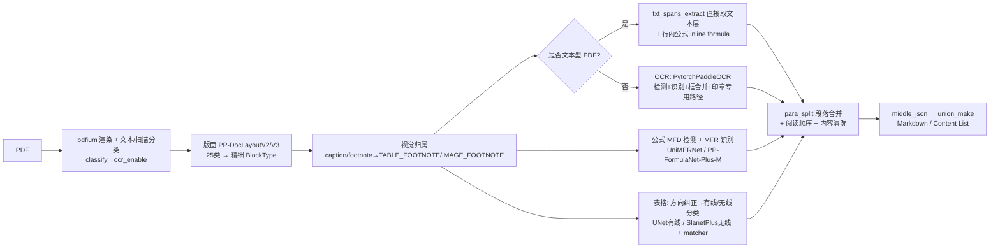

# MinerU 源码级深度对比与可借鉴点（2026-08）

> 基于克隆源码：`mineru/`（opendatalab/MinerU，浅克隆快照）。
> 对比对象：我们的 OCR/解析链路 `backend/app/services/parsekit/`（PP-DocLayoutV3 + GLM-OCR）。

## 1. MinerU pipeline 后端链路（源码确认）

关键源码：
- 编排：`mineru/backend/pipeline/pipeline_analyze.py`（批处理窗口 64 页、流式）
- 预处理/版面：`pipeline_magic_model.py`（`PP_DOCLAYOUT_V2_LABELS_TO_BLOCK_TYPES`、`__classify_visual_blocks`）
- 视觉归属：`utils/visual_magic_model_utils.py`（`find_best_visual_parent`、`is_visual_neighbor`、`is_block_outside_visual_gap`）
- OCR：`model/ocr/pytorch_paddle.py`（PaddleOCR PyTorch 移植，多语言、seal 专用）
- 公式：`model/mfr/unimernet/` + `model/mfr/pp_formulanet_plus_m/`
- 表格：`model/table/cls/`（方向+有线无线分类）+ `model/table/rec/unet_table/` + `slanet_plus/`
- 段落合并：`backend/pipeline/para_split.py`
- 模型单例：`backend/pipeline/model_init.py`（ModelSingleton + AtomModelManager + 锁）

## 2. 双方链路对照表

| 环节 | 我们（parsekit V3 + GLM-OCR） | MinerU pipeline |
|------|------|------|
| 渲染 | PyMuPDF 整页 PNG DPI=200 | pdfium 渲染 + **文本/扫描分类** |
| 文本型 PDF | 仍走 GLM-OCR | 直接提取文本层，不 OCR |
| 版面 | PP-DocLayoutV3，25→11 类映射 | PP-DocLayoutV2/V3，25→**30+ 精细类型**（含 ABSTRACT/CODE/INDEX/VERTICAL_TEXT/INTERLINE_EQUATION/FOOTNOTE） |
| 视觉归属 | 无（caption/footnote 平铺） | **caption/footnote 归属到表格/图片**（TABLE_FOOTNOTE/IMAGE_FOOTNOTE） |
| 正文 OCR | GLM-OCR 大模型（块级） | PytorchPaddleOCR 小模型（检测+识别+框合并） |
| 公式 | GLM-OCR 直接 LaTeX（无检测/识别分离） | MFD 检测 + MFR 识别两段式 |
| 表格 | GLM-OCR 直接 HTML | 方向纠正→有线/无线分类→UNet/SlanetPlus+matcher |
| 印章/竖排 | 无专项 | seal 检测+矫正+专用 OCR；VERTICAL_TEXT 专项 |
| 阅读顺序 | V3 内置 order_seq | layout index 排序 + 视觉归属修正 |
| 段落合并 | 无（逐块输出） | para_split 按标题/公式分组合并 |
| 中间表示 | layout.json v1.2 | middle_json（preproc_blocks→para_blocks） |
| 模型管理 | 单例缓存（_ENGINE_CACHE） | ModelSingleton + AtomModelManager + 推理锁 |
| 批处理 | 页并发 4 × 块并发 8 | 64 页窗口批量推理 |
| 任务/容错 | FastAPI 任务状态机 + U11 partial + U13 failed | CLI/批量，显存自适应清理 |

## 3. 优缺点

### 我们（GLM-OCR 统一大模型）

优点：
- 部署轻：V3 + GLM-OCR 两个组件，无 7+ 小模型维护；
- 语义统一：正文/表格/公式同一模型，表格 HTML、公式 LaTeX 一步到位；
- 工程闭环：任务状态机、按页进度、partial 容错、前端联动齐全；
- 模型升级简单：换 GLM-OCR 版本即可整体提升。

不足：
- 表格复杂结构（旋转、无线、深合并单元格）依赖 GLM-OCR 单模型能力，无专用兜底；
- 公式无 MFD/MFR 两段式，精度受模型版本约束；
- 文本型 PDF 也跑大模型 OCR，成本浪费；
- **无视觉归属：表格"注"行丢失**（模型输出 vision_footnote 时无法挂回表格）；
- 无段落合并：文本块粒度输出，跨行段落不合并；
- 无印章/竖排专项。

### MinerU

优点：
- 专项模型精度高：公式两段式（UniMERNet CDM 0.968）、表格双路径+方向纠正；
- **视觉归属完善**：caption/footnote 自动归属主体（直接解决我们的表格注行问题）；
- 文本型 PDF 零 OCR，省算力；
- 段落合并、内容清洗、语言检测、多语言 OCR；
- 模型单例+锁、显存自适应、批处理窗口工程化成熟。

不足：
- 7+ 模型部署重，依赖 Paddle 生态，版本耦合高；
- 多模型串行误差累积（版面→OCR→公式→表格）；
- 中文公式/复杂版面需特定模型组合，配置面广；
- 无任务状态机/进度闭环（我们已有）。

## 4. 可借鉴内容（决策状态已定，2026-08）

> 状态：✅ 采纳（已列入 docs/DOCUMENT_PARSING_PLAN.md §13）| ❌ 剔除

| 优先级 | 借鉴点 | 来源 | 状态 |
|---|---|---|---|
| P0 | **视觉归属：caption/footnote → 表格/图片**（TABLE_FOOTNOTE） | `visual_magic_model_utils.py` | ✅ 采纳：footnote 归属表格后合并 bbox 随表格进 GLM-OCR，直接解决"注"行丢失 |
| P0 | **文本型 PDF 分类跳过 OCR** | `pipeline_analyze.py::_get_ocr_enable` + `pdf_classify` | ✅ 采纳：纯规则分类，文本型直接取文本层 |
| P1 | **段落合并 para_split** | `backend/pipeline/para_split.py` | ✅ 采纳：按标题/公式分组合并 |
| P1 | ~~公式编号独立~~（FORMULA_NUMBER） | `enum_class.py` | ❌ 剔除：正文引用收益低，维持编号并入公式 |
| P2 | **内容清洗** | `visual_magic_model_utils.py` | ✅ 采纳：输出统一清洗规则 |
| P2 | **语言检测** | `utils/language.py` + fasttext lid.176 | ✅ 采纳：沿用 MinerU 方案（fast-langdetect，0.9MB，CPU，~0.16ms） |
| P1 | ~~表格方向纠正 + 有线/无线分类~~ | `model/table/cls/` | ❌ 剔除：无专用模型，走 GLM-OCR |
| P2 | ~~行内公式 inline formula~~ | `pipeline_magic_model.py` | ❌ 剔除：V3 无 inline_formula 标签 |
| P2 | ~~印章检测+矫正+专用 OCR~~ | `model/ocr/seal_*` | ❌ 剔除：无专用模型 |

## 5. 结论

- 架构路线不同：MinerU 是"多小模型组合拳"，我们是"单大模型统一识别"；两者各有所长，我们当前的
  轻量路线与"企业内网、减少组件"目标一致，不应整体切换。
- **已确定借鉴 5 项**（视觉归属、文本型 PDF 分类、段落合并、内容清洗、语言检测），
  全部为纯工程/规则或轻量 CPU 模型，不引入 GPU 专用模型。
- **已剔除 4 项**（表格方向/有线无线分类、行内公式、印章专项、公式编号独立），
  均依赖专用模型、与 GLM-OCR 路线冲突或收益低。
- 落地顺序与验收标准见 docs/DOCUMENT_PARSING_PLAN.md §13。

参考：`mineru/mineru/backend/pipeline/`、`mineru/mineru/model/`、`mineru/mineru/utils/`
