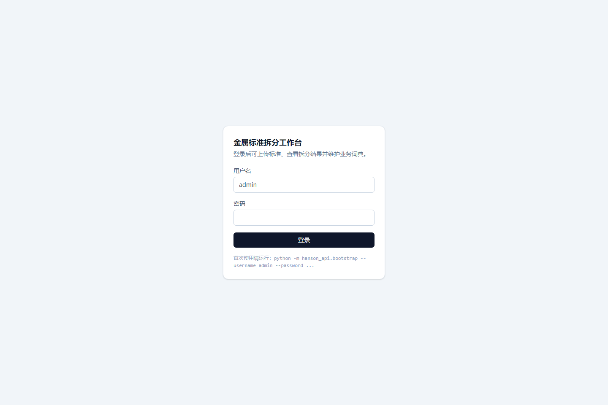
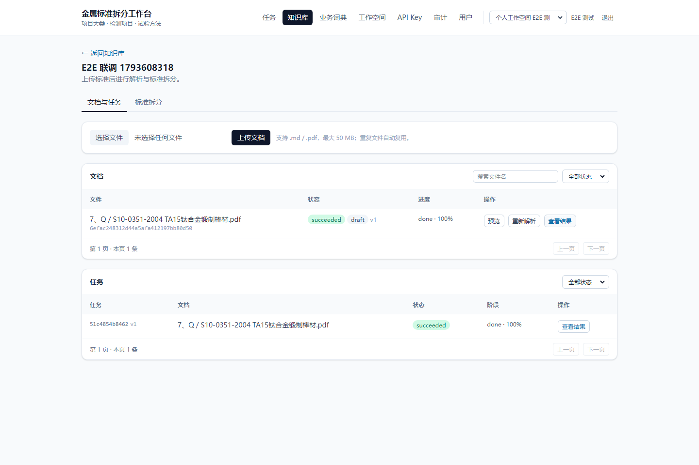
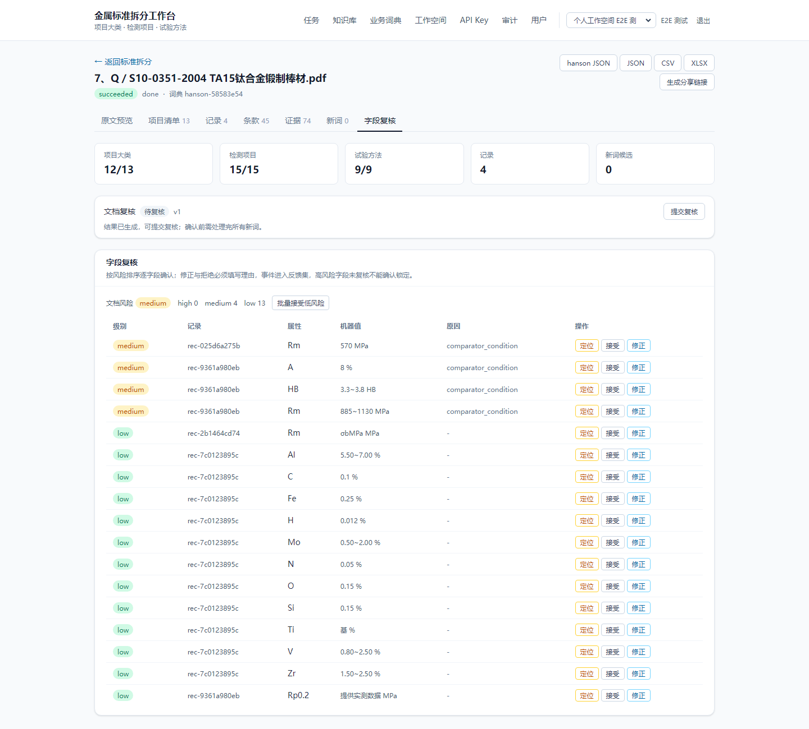
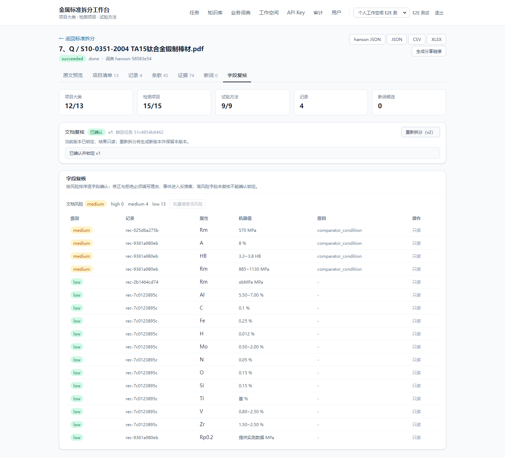
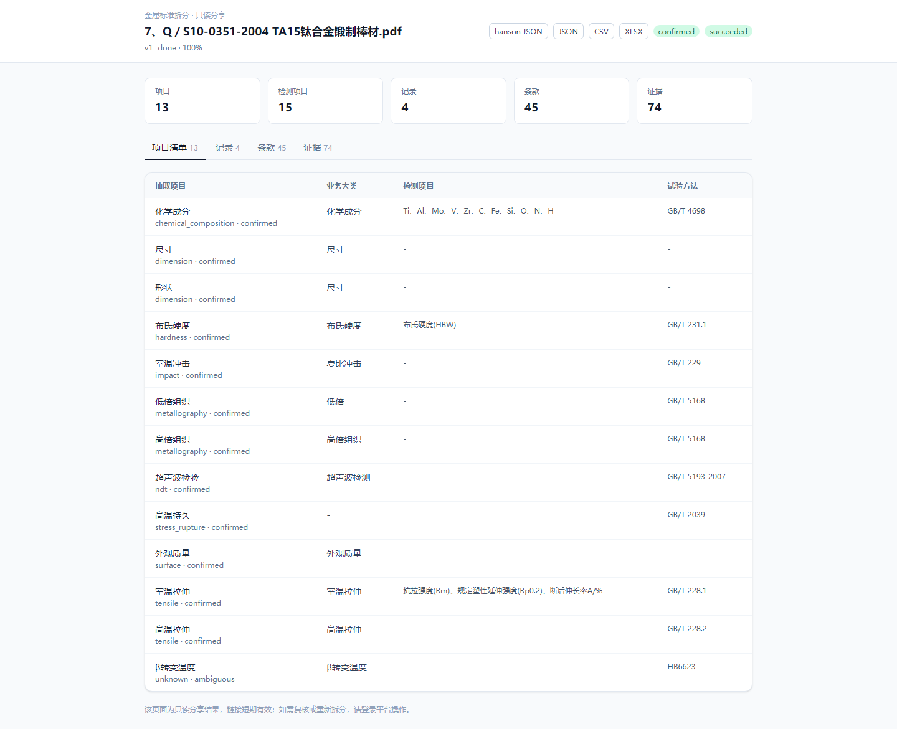
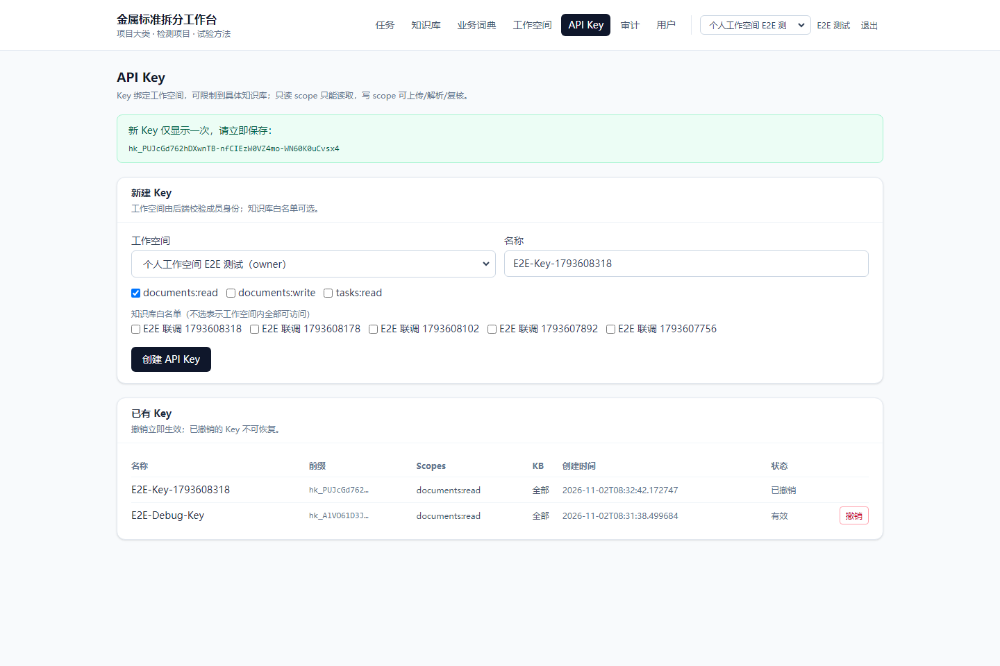

# 前端全链路功能测试报告（生产栈 E2E）

- 测试日期：2026-11-02
- 测试入口：`http://127.0.0.1:8080`（nginx → platform-api）
- 测试方式：Playwright + 真实 Chromium 浏览器，在 Docker 生产栈上执行端到端操作；OCR、版面与抽取均调用真实模型服务（非 mock）
- 测试账号：`e2e_prod` / `E2E-Prod-2026!`（admin）
- 测试文档：`标准文件/7、Q／S10-0351-2004   TA15钛合金锻制棒材.pdf`（1.22 MB）

## 1. 结论

**通过。** 主流程 14 个用例中 13 个在首轮脚本内通过，“标准拆分列表”一项因脚本定位问题跳过，由补充脚本单独验证通过；页面无 `console error`、无 `pageerror`、无 5xx 响应。唯一请求失败为撤销 API Key 时 `DELETE` 被浏览器中断（后端已生效，界面显示“已撤销”），判定为非致命。

- 上传 → 解析 → 结果 → 复核 → 导出 → 分享 → 管理页 全链路可用。
- 1.22 MB PDF 解析端到端耗时 **27.7 s**（含上传、排队、OCR、抽取、结果同步）。
- 4 种导出与分享下载均成功，文件大小与内容格式正确。
- 本次测试发现并修复了 2 个真实阻塞：nginx 默认 1 MB 上传限制（413）、worker 走 Docker bridge 导致模型请求间歇 90 s 挂起。

## 2. 环境与部署状态

| 服务 | 镜像 | 端口 | 状态 |
| --- | --- | --- | --- |
| web（nginx + Vite 产物） | `hanson-r1-web:r6-11` | 8080 → 80 | Up |
| platform-api | `hanson-r1-platform-api:r6-10` | 8000（内部） | Up (healthy) |
| engine-api | `hanson-r1-engine-api:r6-11` | 8010（内部） | Up (healthy) |
| worker-prod | `hanson-r1-worker-prod:r6-11` | host 网络 | Up |
| worker-explore | `hanson-r1-worker-explore:r6-11` | host 网络 | Up |
| postgres | `postgres:16-alpine` | 内部 | Up (healthy) |

模型面（`192.168.188.75`）：

| 模型 | 端点 | 状态 |
| --- | --- | --- |
| GLM-OCR（vLLM） | `:9977/v1` | 200 |
| PP-DocLayoutV3（GPU） | `:9979/health` | `status=ok, loaded=true, device=cuda:0` |
| PP-DocLayoutV3（CPU 回退） | `:9978` | 已部署 |
| Qwen3.5-9B + adapter-v5 | `:9991/v1` | 200 |

平台 `/health` 返回 `ocr_backend=glm`、`extractor_backend=qwen`，业务词典已加载（`hanson-58583e54`）。

## 3. 用例与结果

| # | 用例 | 关键断言 | 耗时 | 结果 | 截图 |
| --- | --- | --- | --- | --- | --- |
| 1 | 登录 | 登录页标题可见；登录后侧边栏“知识库”可见 | 0.6 s | passed | [01](e2e-screenshots-2026-11-02/01-login.png) [02](e2e-screenshots-2026-11-02/02-after-login.png) |
| 2 | 创建知识库 | 新知识库卡片出现在列表；详情页标题正确 | 0.4 s | passed | [03](e2e-screenshots-2026-11-02/03-kb-list.png) [04](e2e-screenshots-2026-11-02/04-kb-created.png) |
| 3 | 上传 PDF + 开始解析 | 上传后文件名可见；解析进入终态（`succeeded`/`review`）且出现“查看结果” | 27.7 s | passed | [05](e2e-screenshots-2026-11-02/05-uploaded.png) [06](e2e-screenshots-2026-11-02/06-parsing.png) [07](e2e-screenshots-2026-11-02/07-parse-ready.png) |
| 4 | 任务详情与 4 个结果 Tab | 记录含 `TA15`、抽取项目、条款号、证据页码均可见 | 6.5 s | passed | [08](e2e-screenshots-2026-11-02/08-job-detail.png) [09](e2e-screenshots-2026-11-02/09-records.png) [10](e2e-screenshots-2026-11-02/10-items.png) [11](e2e-screenshots-2026-11-02/11-clauses.png) [12](e2e-screenshots-2026-11-02/12-evidence.png) |
| 5 | 原文预览 | 跳转 `/viewer`，出现“返回知识库” | 0.1 s | passed | [13](e2e-screenshots-2026-11-02/13-viewer.png) |
| 6 | 新词复核 | 接受新词并确认，事件写入成功 | 2.5 s（1 条） | passed | [14](e2e-screenshots-2026-11-02/14-new-terms.png) |
| 7 | 字段复核 | “文档风险”区块可见，低风险字段批量接受 | 1.4 s | passed | [15](e2e-screenshots-2026-11-02/15-field-review.png) |
| 8 | 提交并锁定复核 | 出现“确认复核（锁定）”；确认后任务锁定 | 1.8 s | passed | [16](e2e-screenshots-2026-11-02/16-review-submitted.png) [17](e2e-screenshots-2026-11-02/17-review-confirmed.png) |
| 9 | 导出 | hanson JSON / JSON / CSV / XLSX 四种下载成功 | 0.9 s | passed | [18](e2e-screenshots-2026-11-02/18-exports.png) |
| 10 | 分享链接 | 新标签页打开分享页；分享页可下载 hanson JSON | 0.5 s | passed | [19](e2e-screenshots-2026-11-02/19-share-page.png) |
| 11 | 管理页 | 任务中心、业务词典、工作空间、API Key、审计日志、用户管理均正常渲染 | 0.6 s | passed | [20](e2e-screenshots-2026-11-02/20-tasks.png) [21](e2e-screenshots-2026-11-02/21-dictionary.png) [22](e2e-screenshots-2026-11-02/22-workspaces.png) [23](e2e-screenshots-2026-11-02/23-api-keys.png) [24](e2e-screenshots-2026-11-02/24-audit.png) [25](e2e-screenshots-2026-11-02/25-users.png) |
| 12 | API Key 创建与撤销 | 新 Key 仅显示一次；撤销后行内状态为“已撤销” | 1.6 s | passed | [26](e2e-screenshots-2026-11-02/26-api-key-created.png) [27](e2e-screenshots-2026-11-02/27-api-key-revoked.png) |
| 13 | 标准拆分列表 | 知识库 → “标准拆分”列表包含该文档 | — | 主脚本 skipped，补充脚本 passed | [28](e2e-screenshots-2026-11-02/28-extractions.png) |
| 14 | 退出登录 | 回到 `/login` 且登录页标题可见 | 0.1 s | passed | [29](e2e-screenshots-2026-11-02/29-logout.png) |

### 导出产物

| 类型 | 文件名 | 大小 |
| --- | --- | --- |
| hanson JSON | `6efac248…-hanson.json` | 9 665 B |
| 原始 JSON | `6efac248…-json.json` | 127 797 B |
| CSV | `6efac248…-csv.csv` | 1 613 B |
| XLSX | `6efac248…-xlsx.xlsx` | 12 716 B |
| 分享页 hanson JSON | `6efac248…-hanson.json` | 9 665 B |

### 关键页面

登录页与解析完成态：





字段复核与确认锁定：





分享页与 API Key 管理：





## 4. 浏览器侧异常观测

| 观测项 | 结果 |
| --- | --- |
| `console.error` | 0 |
| `pageerror` | 0 |
| HTTP 5xx | 0 |
| 请求失败 | 1 条：`DELETE /v1/api-keys/b25acfcf… net::ERR_ABORTED` |

撤销 Key 的 `DELETE` 被浏览器标记为中断，但后端返回 204 且列表刷新后状态为“已撤销”，属于浏览器取消后续重定向/响应读取的行为，不影响功能。已撤销的 Key 仍保留在列表中用于审计追溯，属预期设计。

## 5. 发现的问题与修复

### 5.1 上传 1.22 MB PDF 返回 413（阻塞，已修复）

- 现象：通过前端上传 1.22 MB PDF 时 nginx 直接返回 `413 Request Entity Too Large`。
- 原因：`infra/docker/nginx.conf` 未设置 `client_max_body_size`，继承默认 1 MB。
- 修复：server 块增加 `client_max_body_size 100m;`（[nginx.conf](file:///f:/hanson/hanson_doc_parse/infra/docker/nginx.conf#L7)）。
- 持久化：重新构建 `hanson-r1-web:r6-11` 并用该镜像重建 `hanson-r1-web-1`，容器内配置已确认包含该指令；重建后再次执行浏览器冒烟（登录 → 知识库 → API Key），无 `pageerror`。

### 5.2 worker 访问模型服务间歇 90 s 挂起（阻塞，已修复）

- 现象：解析偶发单页 OCR 耗时 300–500 s，服务端实际早已完成；Windows 宿主直连正常。
- 原因：worker 走 Docker bridge/NAT 访问 `192.168.188.75` 的流式响应时出现 90 s 停滞。
- 修复：`worker-prod` / `worker-explore` 改为 `network_mode: host`（[compose.yaml](file:///f:/hanson/hanson_doc_parse/infra/docker/compose.yaml#L157-L159)）。
- 验证：同一文档 101 s → 10 s；全量 25 份/434 页压测 1764 s，全部 ≤300 s（见 [production-readiness-plan-2026-10-31.md](file:///f:/hanson/hanson_doc_parse/docs/production-readiness-plan-2026-10-31.md) 26.8）。

### 5.3 测试脚本自身问题（非产品缺陷）

| 问题 | 处理 |
| --- | --- |
| 任务仍在 `orchestrating` 时点击“查看结果”导致早退 | `wait_parse` 增加 `succeeded`/`review` 终态判断 |
| 结果页不是 `tbody tr` 结构，行数统计为 0 | 改为断言关键业务文本（`TA15`、抽取项目、条款号、页码） |
| 逐行点击“接受”造成同一按钮被重复点击 | 改为“接受低风险字段”批量操作，并在确认失败时按行各点一次 |
| 管理页 `工作空间` 标题与“新建工作空间”文本 strict mode 冲突 | 使用 `exact=True` |
| API Key 页“工作空间”下拉无 accessible label | 使用页面自动选中的当前工作空间，直接填写名称创建 |
| 主脚本在 `/api-keys` 页查找知识库链接，导致“标准拆分”跳过 | 补充脚本先回到 `/kb` 再进入知识库验证 |

## 6. 测试数据清理

| 对象 | 处理 |
| --- | --- |
| 5 个 `E2E 联调 *` 知识库 | 已删除（HTTP 204） |
| 对应 5 份文档 | 已删除（HTTP 204） |
| `E2E-Key-*`、`E2E-Debug-Key` | 已撤销（HTTP 204，列表中保留“已撤销”记录） |
| 工作空间 | 保留 `个人工作空间 E2E 测试` 与账号 `e2e_prod`，供后续人工复测 |

## 7. 遗留事项与建议

1. `platform-api` 仍运行 `r6-10`，其余服务为 `r6-11`。功能已验证通过，但版本不一致；建议统一重建升级后再做一次冒烟。
2. 自动测试脚本当前位于临时目录，未纳入仓库；如需回归流水线，建议将登录/上传/解析/导出主链路脚本固化到 `e2e/` 并接入 CI。
3. 本轮仅覆盖 1 份标准文档的完整交互路径；多文档并发、超大文件（>50 MB）、扫描件低质量、断网重试等边界场景未在浏览器层验证，性能与全量正确性见生产就绪计划 26.x 节。
4. `e2e_prod` 为 admin 测试账号，若交付给外部使用，建议改为普通成员账号或按需停用。

## 8. hanson JSON 结构升级验证（追加）

按方案 A 将 `hanson JSON` 改为“标准信息 + 项目信息 + 热处理信息”的精简 hansonDoc 结构：

- `GET /v1/documents/{id}/result/schema` 返回同一结构；`hanson JSON` 导出与该接口结果完全一致。
- TA15 实测：13 个类别、26 条记录；标准名称为“TA15 钛合金锻制棒材”，室温 20℃ 数据只落在“室温拉伸”，500℃ 数据落在“高温拉伸”。
- 结构不再输出 `rejected`、`hit_score`、`recall`、`score_bands`，空的可选字段不写入；`missing_fields` 只统计必填字段。
- 导出文件大小 10,061 字节，`schema_equal=true`（接口与导出一致）。

## 9. 复现方式

```powershell
# 1) 启动生产栈（仓库根目录）
cd infra\docker
docker compose -p hanson-r1 up -d

# 2) 浏览器打开
#    http://127.0.0.1:8080
#    账号 e2e_prod / E2E-Prod-2026!
```

自动化复跑需要本机 Playwright 环境，执行流程为：登录 → 创建知识库 → 上传 `标准文件/7、Q／S10-0351-2004   TA15钛合金锻制棒材.pdf` → 开始解析 → 查看结果 → 复核 → 导出 → 分享 → 管理页 → 退出。
