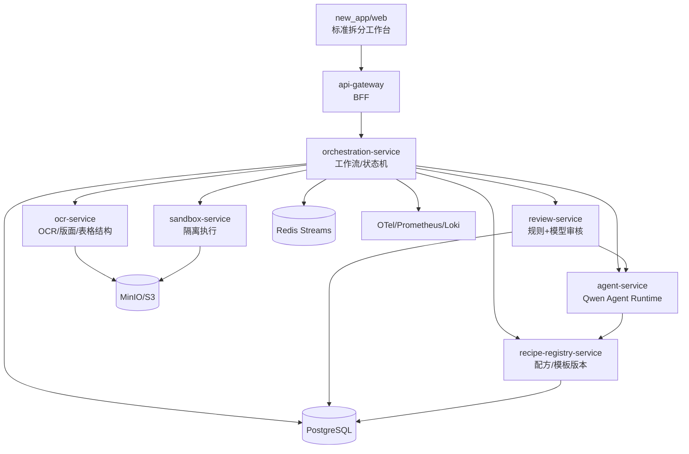
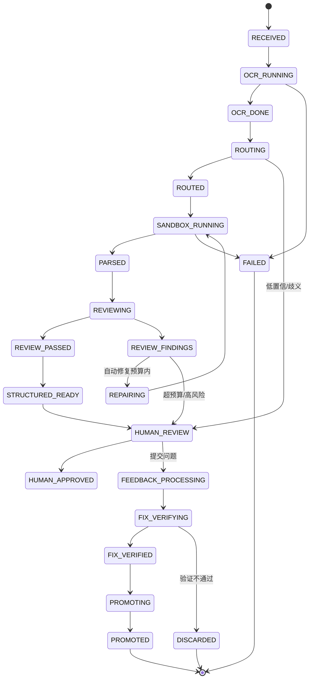

# Hanson 标准拆分平台重构方案（new_app 绿地方案）

> 版本：v2.0  
> 日期：2026-11-11  
> 文档状态：**正式指导方案**（本项目重构工作的唯一架构依据）  
> 配套文档：[项目需求文档](requirements.md)、[项目决策记录](decision-log.md)、[整体开发计划](development-plan.md)  
> 代码目录：`f:\hanson\hanson_doc_parse\new_app\`  
> 范围：标准拆分核心业务线的前后端、解析引擎、配方/模板、沙箱、智能体、审核与反馈闭环  
> 原则：**旧代码只做参考，不直接改造复用；新代码全部在 `new_app/` 内重新实现。**

---

## 0. 执行摘要

### 0.1 一句话方案

在 `new_app/` 中绿地重建“标准拆分”单一业务线：以 **微服务** 拆分 API 网关、编排、OCR、智能体、沙箱、配方注册、审核七个可独立部署的服务；以 **不可变配方包 + 版本化沙箱** 承载解析代码；以 **Qwen Agent Runtime** 统一路由、审核、修复、反馈处理；以 **事件溯源 + RunManifest** 实现全链路可观测、可回放；彻底移除权限、计费、租户、工作区、用户、模块、集成等非核心逻辑。

### 0.2 目标架构一览



### 0.3 核心决策

| # | 决策 | 说明 |
|---|---|---|
| D1 | **`new_app/` 绿地重构** | 旧 `apps/`、`metal-doc-agent/` 冻结为参考；新代码不 import 旧包 |
| D2 | **只保留标准拆分一条业务线** | 移除权限、计费、租户、工作区、用户、API Key、模块、集成、分享等 |
| D3 | **微服务优先** | 按独立部署、独立扩缩容、独立替换拆分七个服务 |
| D4 | **配方 = 不可变包 + 版本化沙箱** | 配方代码、模板、测试、digest 一起版本化；晋升是原子指针切换 |
| D5 | **Qwen Agent Runtime 独立服务** | 统一 Session、上下文压缩、长任务分段、工具、断点、遥测 |
| D6 | **解析算法允许重写** | 表格、矩阵、条款、Schema 投影若有更优实现，按基准测试门槛重写 |
| D7 | **事件溯源 + RunManifest** | 每个阶段有输入/输出/版本/哈希，可回放、可 diff、可审计 |
| D8 | **前端部分重建** | 只重建标准拆分核心页面；旧前端仅参考；不做登录/用户/工作区等页面 |

### 0.4 明确移除的内容

**后端移除**

- 登录、JWT、密码、API Key、RBAC、角色、权限点、用户管理。
- 租户、工作区、成员、邀请、配额、计费、账单。
- 知识库（`kb_id`）、知识库成员、知识库隔离。
- 模块管理（`modules`）、模块配置、模块路由。
- 集成任务、集成回调、集成 session token。
- 分享令牌、分享页、只读链接。
- 审计日志管理页与管理员端点；运行审计改为 `run_events` + `operator` 字段。
- 旧 `selfheal` 独立服务、旧 `apps/api` 路由、旧 `apps/worker` 入口。

**前端移除**

- 登录页、用户管理页、API Key 页、工作区/成员/邀请页。
- 模块布局（`ModuleLayout`）、模块占位页、订单/证书/外包模块。
- 集成结果页、分享页、审计日志管理页、关于/帮助等非核心页。
- 知识库导航与知识库切换。

**保留的核心页面**

- 文档库（上传、列表、删除）。
- 标准拆分列表（按文档查看解析/审核/反馈状态）。
- 解析详情（结果、审核、反馈、验证、时间线、版本对比、原文预览）。
- 文档预览（页图 + 版面定位）。
- 业务词典（标准拆分所需）。
- 任务/运行列表。
- 配方版本（只读 + 回滚）。

### 0.5 成功标准

| 标准 | 验收方式 |
|---|---|
| 只有标准拆分一条业务线 | 新前端路由、新 API、新数据库表中无权限/租户/计费/工作区概念 |
| 新旧代码完全隔离 | `new_app/` 不 import 旧包；旧代码不改动 |
| 微服务可独立部署 | 每个服务有独立镜像、端口、健康检查、HPA |
| 解析可复现 | 同一输入 + 配方 digest + 引擎 digest，输出哈希一致 |
| 修复可验证 | 用户通过则原子晋升；不通过则丢弃，稳定版不变 |
| 长任务不截断 | 上下文压缩无损、分段执行、断点续跑 |
| 全链路可回溯 | `trace_id → run_id → stage → artifact → model call` 完整 |
| 旧数据策略清晰 | 默认不导入旧文档/运行/产物；仅导入词典；新旧效果对比有报告，达标则全量重生成 |

---

## 1. 范围、约束与执行原则

### 1.1 业务主链路

```text
文件上传
  → OCR 解析（页图 / Markdown / 版面 / 表格结构）
  → 模型判断匹配配方/模板
  → 沙箱执行配方/模板代码完成解析
  → 模型审核文档内容与解析结果
  → 发现问题：配方修复 → 沙箱重跑 → 再审核（有界循环）
  → 结构化结果展示
  → 人工审核提交问题反馈
  → 模型全链路处理：根因分析 → 配方兼容性修改 → 沙箱定向重解析验证
  → 用户验证
      → 通过：自动晋升代码版本，后续沙箱统一使用最新稳定版
      → 不通过：丢弃本次修复，稳定版不变
```

### 1.2 本次执行约束

| # | 约束 | 执行方式 |
|---|---|---|
| 1 | 解析算法默认不重写，但有更优方案可重写 | 保留行为契约；表格、矩阵、条款、Schema 投影可按基准测试门槛重写 |
| 2 | 权限、计费、租户模型完全不实现 | 前后端移除相关逻辑；新系统无用户/角色/租户/工作区/配额/账单 |
| 3 | 微服务若更优则优先 | 采用七服务架构，独立部署、扩缩容、替换 |
| 4 | 模型窗口可放大；数据/测试向新架构适配 | 窗口可配置 32K/64K/128K；并发 4 基准选优；旧数据仅作对比基线；旧测试重写；指标重新基线 |
| 5 | 整体重构，前端部分重构；旧代码不直接复用 | 旧代码只读参考；可用逻辑复制到 `new_app` 后重写优化；记录 provenance |
| 6 | 所有新代码放入 `new_app/` | 前端、后端、部署、测试、脚本全部在 `new_app/` 内 |

### 1.3 旧代码复用规则

**允许**

- 阅读旧代码，理解业务规则、边界条件、字段含义。
- 将经过验证的纯逻辑复制到 `new_app/` 的新文件中，重新组织接口、错误处理、测试。
- 复用配置数据、词典快照、配方数据、金标语料、提示词文本。
- 复用测试用例的输入/期望输出，重写为新架构测试。

**禁止**

- `import metal_doc_agent`、`import hanson_api` 或任何旧包。
- 直接复制旧模块后只改 import。
- 让新服务依赖旧数据库、旧任务目录、旧产物格式。
- 修改旧代码来适配新架构。

**复用流程**

```text
旧文件
  → 标记来源（路径 + commit）
  → 复制到 new_app 的 algorithms/ 或 adapters/
  → 去掉旧依赖（pipeline/jobs/settings）
  → 提取纯函数/类，定义新接口
  → 补单元测试 + 基准测试
  → 记录 PROVENANCE.md
```

### 1.4 目标非目标

| 目标 | 非目标 |
|---|---|
| 标准拆分主链路跑通 | 多业务线、多租户 SaaS |
| 配方/模板可执行、可版本化 | 配方可视化编辑器 |
| 模型审核、反馈、修复、晋升闭环 | 通用低代码平台 |
| 微服务独立部署/扩缩容 | 服务数量最大化 |
| 全链路可观测/可回放 | 全量历史数据在线兼容 |
| 前端核心页面重建 | 旧前端全页面迁移 |

### 1.5 已确认决策（Q1–Q8）

> 详细记录见 [项目决策记录](decision-log.md)，需求见 [项目需求文档](requirements.md)。

| 确认项 | 决策摘要 |
|---|---|
| Q1 K8s 环境 | 代码层面用本地 **WSL** 完成 K8s 安装/配置/功能测试；生产仍按 K8s 设计 |
| Q1 模型操作 | 所有模型操作在**模型服务器**执行；业务服务不在模型服务器运行 |
| Q1 模型访问 | 共**三个地址**：旧代码两种 + 新增 `192.168.1.35`；任一地址连续 **10 秒**无法连接自动切换至下一个可用地址；防抖/回切；Qwen 固定 **35B**，其他模型版本参考旧代码 |
| Q2 窗口 | 并发 **4**、与 GLM/Layout 共跑，基准选择 32K/64K/128K；默认 64K 可配 |
| Q2 看门狗 | 监控模型服务器剩余内存，低于阈值主动终止测试进程，防止死机 |
| Q3 沙箱 | containerd/Kata/gVisor 按安全/开销/兼容性/运维评分，M4 PoC 后选定 |
| Q4 数据 | 不默认全量导入旧数据；仅导入业务词典；重构后效果对比，达标则全部重新生成，未达标再确认导入范围 |
| Q5 前端视觉 | 完全沿用现有产品风格规范 |
| Q6 对象存储 | 本地开发/测试统一使用 MinIO；生产 S3 兼容 |
| Q7 API 前缀 | 公开 API 保留 `/v1` |
| Q8 人力 | 当前 1 人，所有角色兼任，里程碑串行推进 |

---

## 2. 旧系统评估与提取清单

### 2.1 旧代码处置

| 旧目录/模块 | 处置 | 说明 |
|---|---|---|
| `metal-doc-agent/metal_doc_agent/ocr/` | 参考/提取 | OCR 适配、页图、版面调用逻辑 |
| `metal-doc-agent/metal_doc_agent/tablegrid/` | 参考/重写 | 表格结构、rowspan/colspan、修复规则 |
| `metal-doc-agent/metal_doc_agent/extraction/` | 参考/重写 | 矩阵、条款、非记录抽取 |
| `metal-doc-agent/metal_doc_agent/schema_projection.py` | 参考/重写 | Schema 投影改为声明式映射 |
| `metal-doc-agent/metal_doc_agent/recipes/` | 数据迁移 | 配方 JSON 转为配方包；代码不直接复用 |
| `metal-doc-agent/metal_doc_agent/validation/`、`review/` | 参考/提取 | 规则、风险、Finding 词汇 |
| `metal-doc-agent/metal_doc_agent/selfheal/` | 参考/重写 | 反馈、诊断、修复思想；服务本身废弃 |
| `metal-doc-agent/metal_doc_agent/orchestration/` | 参考/重写 | 图、上下文、检查点思想 |
| `metal-doc-agent/metal_doc_agent/sandbox_exec.py` | 参考/重写 | 仅作为开发期子进程实现参考 |
| `metal-doc-agent/configs/` | 数据迁移 | 词典、配方、模板、修复规则 |
| `apps/api/hanson_api/` | 不迁移 | 认证、KB、用户、工作区、模块、集成全部移除 |
| `apps/web/` | 参考/部分重建 | 只重建标准拆分核心页面 |
| `apps/worker/` | 不迁移 | 由 orchestration-service 替代 |
| `infra/` | 参考 | 新架构按 K8s 优先重新设计 |
| `e2e/` | 参考 | 重写为 new_app E2E |
| `training/`、`metal-standard-agent-plan/` | 参考 | 模型训练与里程碑文档不进入新代码 |

### 2.2 提取优先级

| 优先级 | 内容 | 目标位置 |
|---|---|---|
| P0 | 表格结构解析、矩阵抽取、条款抽取、Schema 投影 | `new_app/services/ocr/algorithms/`、`new_app/services/orchestration/algorithms/` |
| P0 | 词典匹配、业务编码、证据定位 | `new_app/services/orchestration/domain/` |
| P1 | 配方数据、模板数据、修复规则 | `new_app/services/recipe_registry/data/` |
| P1 | Qwen prompt、输出 schema、评测样本 | `new_app/services/agent/prompts/`、`tests/algorithm/` |
| P2 | 前端结果表格、预览、反馈交互模式 | `new_app/web/components/`（重写） |
| P3 | 评测脚本、回放脚本 | `new_app/scripts/benchmark/` |

### 2.3 不提取的内容

- 任何认证、JWT、密码、API Key、RBAC、用户、角色、权限点代码。
- 租户、工作区、成员、邀请、配额、计费、账单代码。
- 知识库、知识库成员、知识库隔离代码。
- 模块管理、模块配置、模块占位页。
- 集成任务、集成回调、集成 token。
- 分享令牌、分享页。
- 旧 API 路由、旧 worker 入口、旧 selfheal 服务。
- 旧 `Settings`/`SelfHealSettings` 的环境变量体系（重新设计配置）。

### 2.4 PROVENANCE 记录

每个从旧代码提取的文件必须有来源头：

```python
# PROVENANCE
# source: metal-doc-agent/metal_doc_agent/tablegrid/parser.py@<commit>
# copied_at: 2026-11-11
# reason: rowspan/colspan grid expansion rules
# changes:
#   - extracted pure functions
#   - removed pipeline/settings dependencies
#   - added typed TableGrid contract
```

`new_app/PROVENANCE.md` 维护总表：

| 新文件 | 旧来源 | 复用类型 | 改动摘要 | 验证 |
|---|---|---|---|---|
| `services/ocr/algorithms/table_grid.py` | `tablegrid/parser.py` | 复制后重写 | 提取 cell graph | 表格基准 |
| ... | ... | ... | ... | ... |

---

## 3. 解析算法重构策略

### 3.1 原则

- **行为契约优先**：输入/输出、字段含义、证据定位、单位规则保持不变。
- **实现可以重写**：如果新实现更简单、更稳定、更快，允许替换旧算法。
- **基准测试说话**：任何重写必须通过金标语料对比；没有提升就回退到“复制 + 重构”的保守方案。
- **算法与流程解耦**：算法是纯函数/纯服务，不依赖 job、数据库、HTTP。

### 3.2 算法清单与重写候选

| 算法 | 旧实现 | 新方案 | 是否重写 |
|---|---|---|---|
| 表格结构还原 | `tablegrid/parser.py` 启发式 HTML 网格 + 多个修复函数 | 标准 HTML table 模型 + cell graph + rowspan/colspan 归一化 + 声明式修复规则 | 优先重写 |
| 表格修复 | `tablegrid/repairs.py`、`configs/table_repairs.json` | 数据驱动修复规则 + 表签名匹配 + 回归用例 | 重写执行器，保留规则数据 |
| 表型识别 | `tablegrid/profile.py` 关键词/顺序规则 | 特征向量 + 规则优先级 + 可解释原因 | 重写 |
| 矩阵抽取 | `extraction/matrix.py` 多函数、按表型分支 | `MatrixSpec` 声明式引擎：row_key / condition axes / measures / merge policy | 优先重写 |
| 条款抽取 | `extraction/clauses.py` 正则 + 标题启发式 | 条款编号语法树 + 版面块 + 模型兜底 | 优先重写 |
| 非记录抽取 | `extraction/nonrecord.py` | 复用规则，整理为独立抽取器 | 复制重构 |
| Schema 投影 | `schema_projection.py` 4000+ 行 | 声明式映射 DSL + 校验器 + 模板版本 | 优先重写 |
| 覆盖审计 | `coverage/` | 保留规则，改为独立校验器 | 复制重构 |
| 证据定位 | `pipeline.attach_evidence_bboxes` | 版面块索引 + 文本匹配 + bbox 回填 | 复制重构 |

### 3.3 更优实现方案

#### 3.3.1 表格结构

旧实现的问题：

- rowspan/colspan 展开与修复逻辑分散，容易出现跨行泄漏、列错位。
- 修复函数与表型判断耦合，新增表型需要改代码。
- 难以单测单个表的网格。

新实现：

```text
HTML/OCR table
  → CellGraph（每个 cell 记录 row/col/rowspan/colspan/text/bbox）
  → GridNormalizer（惰性展开、越界检测、陈旧跨行丢弃）
  → TableValidator（列数一致、表头完整性、空列/重复列）
  → TableProfile（特征 -> 表型 + 置信度 + 原因）
  → TableGrid（统一契约）
```

修复规则改为 JSON：

```json
{
  "rule_id": "gbt1591_t4_rebuild",
  "match": {"standard_no": "GB/T 1591-2018", "table_caption": "表4"},
  "action": {"type": "rebuild_grid", "columns": 16, "rows": 16},
  "cases": ["tests/algorithms/table/gbt1591_t4.json"]
}
```

收益：

- 网格展开可单测、可复现。
- 新表型只加规则/特征，不改主流程。
- 失败时可输出中间 cell graph，便于定位。

#### 3.3.2 矩阵抽取

旧实现的问题：

- 冲击、硬度、碳当量、化学成分、力学性能各有分支，逻辑重复。
- 条件轴（温度、方向、厚度区间）与度量列耦合。
- 新增表型需要写新函数。

新实现：

```python
class MatrixSpec(BaseModel):
    table_profile: str
    row_keys: list[ColumnRef]          # 牌号、状态
    condition_axes: list[ConditionAxis] # 温度、方向、厚度区间
    measures: list[MeasureRef]          # Rm、Rp0.2、KV2、CEV
    merge_policy: Literal["replace", "append", "fill"]
    validators: list[str]
```

通用执行器：

```text
TableGrid + MatrixSpec
  → 识别 row_key 行
  → 解析 condition_axes（表头/脚注/单位）
  → 解析 measures（列绑定 + 单位 + comparator）
  → 生成 Record/Property/Evidence
  → 运行 MatrixValidator
```

收益：

- 新增矩阵类型 = 新增 `MatrixSpec`，不写代码。
- 条件轴组合（温度 × 方向）统一处理。
- 单元测试按 spec + 输入表 + 期望记录。

#### 3.3.3 条款抽取

旧实现的问题：

- 正则与标题启发式容易把列表项、行内正文误判为条款。
- 条款树、正文归属、跨页续写处理分散。
- 条款字段抽取依赖上下文猜测。

新实现：

```text
页面块 + Markdown
  → ClauseLexer（编号 token、标题、正文、列表项）
  → ClauseParser（编号语法树：1 / 1.1 / 1.1.1 / 附录 A）
  → ClauseTree（父子、正文、跨页合并、重复 ID 合并）
  → ClauseFieldExtractor（取样、温度、方向、方法）
  → 模型兜底（仅对歧义标题）
```

收益：

- 条款结构稳定，列表项不误判。
- 可输出条款树 diff，便于回归。
- 模型只处理歧义，成本可控。

#### 3.3.4 Schema 投影

旧实现的问题：

- 4000+ 行命令式投影，字段规则分散。
- 模板新增/修改需要改代码。
- 难以定位“哪个字段为什么为空”。

新实现：

```json
{
  "template_id": "product_standard",
  "version": "2.0.0",
  "categories": [
    {
      "feature": "检测项目",
      "fields": [
        {"name": "项目名称", "from": "$.item.name", "required": true},
        {"name": "标准要求", "from": "$.record.requirement", "required": true},
        {"name": "试验方法", "from": "$.method.name", "required_when": "method.exists"}
      ]
    }
  ],
  "validators": ["required", "unit", "range"]
}
```

收益：

- 模板 = 数据，不改代码。
- 字段缺口可解释（来源路径 + 原因）。
- 模板版本化，旧 run 冻结旧模板。

### 3.4 重写验收门槛

| 指标 | 门槛 |
|---|---|
| Record F1 | 不低于旧基线 |
| Field F1 | 不低于旧基线 |
| Value F1 | 不低于旧基线 |
| Evidence 命中率 | 不低于旧基线，目标 1.0 |
| Coverage | 不低于旧基线 |
| Silent 错误 | 不增加 |
| 单文档 F1 下降 | ≤0.01 |
| 确定性 | 同输入同配置输出哈希一致 |
| 延迟 | 不超过旧基线 ×1.2 |
| 代码复杂度 | 新增算法模块必须可单测；主流程不得增加分支 |

任一门槛不通过：回退到“复制旧实现 + 重构接口”的保守方案，不强行重写。

### 3.5 算法目录

```text
new_app/
  services/
    ocr/
      algorithms/
        table_grid.py
        table_repairs.py
        table_profile.py
    orchestration/
      algorithms/
        matrix/
          spec.py
          executor.py
          validators.py
        clauses/
          lexer.py
          parser.py
          tree.py
          fields.py
        projection/
          template.py
          mapper.py
          validators.py
  tests/
    algorithm/
      table/
      matrix/
      clauses/
      projection/
      fixtures/
```

---

## 4. 目标架构

### 4.1 微服务拆分

| 服务 | 职责 | 数据所有权 | 扩缩容特征 | 替换场景 |
|---|---|---|---|---|
| `api-gateway` | 公开 API、DTO、SSE、静态资源、限流 | 无 | 无状态，水平扩展 | 换 BFF 框架 |
| `orchestration-service` | 工作流、状态机、幂等、补偿、文档/运行/反馈/晋升 | documents/runs/stages/feedback/proposals/verifications/promotions | 按运行数扩展 | 换工作流引擎 |
| `ocr-service` | OCR、版面、表格结构、页图 | 无业务库；产物写对象存储 | CPU/GPU 密集，独立节点池 | 换 OCR 引擎 |
| `agent-service` | Qwen Agent Runtime、四类 Agent、会话/检查点 | agent_sessions/checkpoints | 按 token/并发扩展 | 换模型/框架 |
| `sandbox-service` | 隔离执行、版本挂载、产物校验 | 无业务库；执行记录 | 按沙箱并发扩展 | 换容器运行时 |
| `recipe-registry-service` | 配方/模板包、版本、通道、兼容性、晋升指针 | recipes/versions/channels/tests | 读多写少 | 换存储/OCI Registry |
| `review-service` | 规则校验、模型审核、Finding 聚合 | review_reports/findings | 按审核量扩展 | 换规则/模型 |
| `web` | 标准拆分工作台 | 无 | 静态资源 | 换前端框架 |

**不拆的服务**

- 文档 CRUD 放在 `orchestration-service`，不单独拆 `document-service`。
- 词典、任务列表作为 orchestration 的领域模块，不单独拆服务。
- 审核规则与审核报告同属 `review-service`，不按规则类型拆。

### 4.2 为什么采用微服务

| 判断标准 | 结论 |
|---|---|
| 独立部署 | OCR、Agent、Sandbox 的发布节奏不同，必须独立 |
| 独立扩缩容 | OCR/沙箱是资源密集，Agent 是 token/并发密集，不能绑在一起 |
| 独立替换 | 换 OCR、换模型、换沙箱运行时不应影响编排 |
| 安全边界 | 沙箱执行不可信代码，必须独立进程/容器/节点 |
| 故障隔离 | 沙箱崩溃不能拖垮编排和网关 |
| 团队并行 | 各服务可独立开发、测试、发布 |

### 4.3 服务内部逻辑分层

每个服务内部仍采用端口适配器：

```text
service/
  domain/          # 实体、值对象、领域服务、端口
  application/     # 用例、DTO 映射、事务边界
  adapters/        # DB、HTTP、对象存储、模型、容器
  api/             # 入口（REST/gRPC/consumer）
  tests/
```

依赖规则：

- `domain` 不依赖任何外部框架。
- `application` 依赖 `domain` 端口，不依赖适配器。
- `adapters` 实现端口。
- `api` 只做协议转换。
- 服务之间只通过 contracts 通信，不共享数据库。

### 4.4 服务通信与一致性

| 场景 | 方式 |
|---|---|
| 前端 → 网关 | REST + SSE |
| 网关 → 编排 | REST/gRPC |
| 编排 → OCR/沙箱/审核/配方 | 同步命令 + 异步事件 |
| 阶段完成/失败 | 事件总线（Redis Streams） |
| 长任务 | 编排状态机 + 检查点 |
| 跨服务事务 | Saga + Outbox，最终一致 |
| 幂等 | `run_id + stage + attempt` |
| 重试 | 仅对可重试错误；指数退避 |
| 补偿 | 释放沙箱、丢弃候选、回滚指针、关闭反馈 |

### 4.5 部署拓扑

**代码验证：本地 WSL + 轻量 K8s**

```text
WSL (k3s/kind/minikube 之一，M0 PoC 固定)
├── 七个服务 + web
├── postgres / minio / redis
├── otel-collector / prometheus / grafana / loki
└── 外部模型服务器（GLM/Qwen/Layout，三地址）
```

- 代码层面的 K8s 安装、配置、功能测试全部在 WSL 完成。
- 模型操作不在 WSL/业务容器内执行，统一在模型服务器执行。
- 本地对象存储固定 MinIO。
- WSL 资源不足时，可临时使用远程 Linux 验证，但方案不变。

**生产：K8s**

```text
namespace: hanson-standard
├── ingress
├── api-gateway (Deployment + HPA)
├── web (Deployment + CDN/静态)
├── orchestration (Deployment + HPA)
├── ocr (Deployment + HPA, node pool: cpu/gpu)
├── agent (Deployment + HPA, node pool: cpu/gpu)
├── sandbox (Deployment + HPA, node pool: sandbox, RuntimeClass)
├── recipe-registry (Deployment)
├── review (Deployment + HPA)
├── postgres (StatefulSet/托管)
├── minio (StatefulSet/对象存储；生产可换 S3 兼容)
├── redis (StatefulSet/托管)
└── otel-collector / prometheus / grafana / loki
```

**开发：Docker Compose**

- 同一套镜像，端口映射到本机。
- MinIO 作为本地对象存储。
- 模型服务指向模型服务器（三地址，含 `192.168.1.35`）或 mock。
- 沙箱开发可用容器；单测用 fake。

**部署要求**

- 每个服务独立镜像、独立健康检查、独立 HPA。
- 沙箱节点与业务节点隔离；NetworkPolicy 默认拒绝。
- 对象存储、Postgres、Redis 独立备份。
- 网关是唯一公网入口。
- 无租户/无登录：单实例单组织部署；`operator` 通过请求头传入，仅用于审计，不做鉴权。
- 模型访问：三地址 + 连续 10 秒失败自动切换；Qwen 35B；其他模型版本参考旧代码。
- 当前人力 1 人：部署与验证按串行推进，不假设多角色并行。

### 4.6 `new_app/` 目录结构

```text
new_app/
  README.md
  PROVENANCE.md
  pyproject.toml
  uv.lock
  .env.example

  packages/
    contracts/
      openapi/
        public.yaml
        internal.yaml
      schemas/
        recipe-package-2.0.json
        run-manifest-1.0.json
        agent-output/
      src/hanson_contracts/
        dto.py
        events.py
        errors.py
    domain/
      src/hanson_domain/
        document/
        run/
        recipe/
        review/
        feedback/
        promotion/
    observability/
      src/hanson_obs/
        trace.py
        metrics.py
        logging.py

  services/
    api_gateway/
      src/hanson_gateway/
        main.py
        routers/
        deps.py
      tests/
    orchestration/
      src/hanson_orchestration/
        main.py
        workflows/
        domain/
        algorithms/
        adapters/
      tests/
    ocr/
      src/hanson_ocr/
        main.py
        algorithms/
        adapters/
      tests/
    agent/
      src/hanson_agent/
        main.py
        harness.py
        session.py
        context/
        segmentation.py
        tools/
        prompts/
      tests/
    sandbox/
      src/hanson_sandbox/
        main.py
        runtime/
        contracts/
      tests/
    recipe_registry/
      src/hanson_recipes/
        main.py
        registry.py
        matcher.py
        package.py
      data/
        recipes/
        templates/
      tests/
    review/
      src/hanson_review/
        main.py
        validators/
        aggregator.py
      tests/

  web/
    src/
      main.tsx
      router.tsx
      pages/
        DocumentsPage.tsx
        ExtractionPage.tsx
        ViewerPage.tsx
        DictionaryPage.tsx
        RunsPage.tsx
        RecipesPage.tsx
      components/
        result/
        review/
        feedback/
        timeline/
        version/
        ui/
      api/
        client.ts
        documents.ts
        runs.ts
        feedback.ts
        recipes.ts
      lib/
    tests/
    package.json
    vite.config.ts

  deploy/
    compose/
      docker-compose.yml
    k8s/
      base/
      overlays/

  tests/
    contract/
    integration/
    e2e/
    algorithm/
    fixtures/

  scripts/
    import_legacy/
    build_recipes/
    benchmark/
    dev/
```

**硬性规则**

- 所有新代码只能写在 `new_app/`。
- 旧 `apps/`、`metal-doc-agent/` 不改动。
- `new_app` 内禁止出现 `import hanson_api`、`import metal_doc_agent`。
- 所有跨服务调用必须走 contracts。
- 所有服务必须有独立 README、健康检查、配置说明。

### 4.7 配置

```text
new_app/.env.example
  DATABASE_URL
  REDIS_URL
  OBJECT_STORAGE_ENDPOINT / BUCKET / ACCESS_KEY / SECRET_KEY
  OCR_BASE_URL / OCR_MODEL
  AGENT_BASE_URL / AGENT_MODEL / AGENT_CONTEXT_WINDOW / AGENT_MAX_OUTPUT_TOKENS
  LAYOUT_BASE_URL
  SANDBOX_IMAGE / SANDBOX_CPU / SANDBOX_MEMORY_MB / SANDBOX_TIMEOUT
  RECIPE_REGISTRY_URL
  OTEL_EXPORTER_OTLP_ENDPOINT
  LOG_LEVEL
```

配置通过 ConfigMap/Secret 注入；每个服务只读自己需要的配置。

---

## 5. 业务主链路与状态机

### 5.1 Run 状态图



### 5.2 状态迁移

| 当前 | 事件 | 目标 | 守卫 | 副作用 |
|---|---|---|---|---|
| RECEIVED | OCR_STARTED | OCR_RUNNING | 文件校验通过 | 创建 OCR 任务，记录 manifest |
| OCR_RUNNING | OCR_SUCCEEDED | OCR_DONE | 页数 > 0 | 落 OCR 产物、质量分 |
| OCR_RUNNING | OCR_FAILED | FAILED | 重试耗尽 | 记录失败码 |
| OCR_DONE | ROUTE_STARTED | ROUTING | — | 生成表摘要，调用 Router |
| ROUTING | ROUTED | ROUTED | 每表有配方或 fallback | 冻结 RecipeRef |
| ROUTING | ROUTE_HUMAN | HUMAN_REVIEW | 低置信/歧义 | 创建人工任务 |
| ROUTED | SANDBOX_STARTED | SANDBOX_RUNNING | 配方/引擎兼容 | 提交沙箱任务 |
| SANDBOX_RUNNING | SANDBOX_SUCCEEDED | PARSED | 产物校验通过 | 落结果 |
| SANDBOX_RUNNING | SANDBOX_FAILED | FAILED | 重试耗尽/不可重试 | 记录诊断 |
| PARSED | REVIEW_STARTED | REVIEWING | — | 规则链 + ReviewAgent |
| REVIEWING | REVIEW_PASSED | REVIEW_PASSED | 无 error/critical | 生成报告 |
| REVIEWING | REVIEW_FINDINGS | REVIEW_FINDINGS | 有 error/critical | 生成 Finding |
| REVIEW_FINDINGS | REPAIR_STARTED | REPAIRING | 迭代 < 3 且预算足够 | 生成候选修复 |
| REPAIRING | REPAIR_RERUN | SANDBOX_RUNNING | 候选包构建成功 | 定向/全量重跑 |
| REPAIRING | REPAIR_EXHAUSTED | HUMAN_REVIEW | 超迭代/高风险 | 转人工 |
| REVIEW_PASSED | STRUCTURED_READY | STRUCTURED_READY | — | 生成结构化视图 |
| STRUCTURED_READY | HUMAN_OPENED | HUMAN_REVIEW | — | 开放人工审核 |
| HUMAN_REVIEW | HUMAN_APPROVED | HUMAN_APPROVED | 必需字段已复核 | 锁定版本 |
| HUMAN_REVIEW | FEEDBACK_SUBMITTED | FEEDBACK_PROCESSING | 反馈合法 | 创建 feedback |
| FEEDBACK_PROCESSING | FIX_PROPOSED | FIX_VERIFYING | 候选包/补丁构建成功 | 沙箱定向重解析 |
| FIX_VERIFYING | FIX_VERIFIED | FIX_VERIFIED | 目标修复 + 无回归 | 生成验证包 |
| FIX_VERIFYING | FIX_REJECTED | DISCARDED | 用户拒绝/回归失败 | 丢弃候选 |
| FIX_VERIFIED | PROMOTE_STARTED | PROMOTING | 用户验证通过 | 原子切换通道 |
| PROMOTING | PROMOTED | PROMOTED | 指针切换成功 | 写审计、通知 |

### 5.3 自动审核修复环

```text
PARSED
  → REVIEWING
  → 有 Finding
  → 按范围生成 RepairProposal：
       1) 文档级覆盖（不改代码）
       2) 配方绑定/配置（candidate recipe）
       3) 配方代码（candidate recipe code）
       4) 引擎代码（candidate engine image）
  → 沙箱重跑（定向 + 回归）
  → REVIEWING（再次）
  → 通过：REVIEW_PASSED
  → 未通过且迭代 < 3：继续
  → 未通过且迭代 = 3：HUMAN_REVIEW
```

约束：

- 修复范围从小到大，禁止第一轮改引擎代码。
- 每轮记录 `iteration/proposal_id/before_run/after_run/diff`。
- 自动修复不能直接进入 stable。
- 预算耗尽或高风险直接转人工。

### 5.4 人工反馈修复环

```text
HUMAN_REVIEW
  → 用户提交 Feedback
  → FeedbackTriageAgent：
       复现目标 → 根因分类 → 修复范围 → RepairProposal
  → RepairAgent：
       生成候选配方包/补丁 + 测试计划
  → 沙箱：
       针对问题内容定向重解析 + 影响面回归
  → VerificationPackage（before/after/diff/regression）
  → 用户验证
       通过 → PromotionWorkflow：原子切换 stable
       不通过 → DiscardWorkflow：候选标记 discarded，stable 不变
```

语义：

- “后续所有沙箱统一使用最新版本” = 新 run 在创建时解析 `stable` 通道得到新版本；运行中的 run 保持冻结版本。
- “验证不通过直接丢弃” = 候选包不可再被引用；注册中心指针不变；产物保留用于审计。

### 5.5 幂等、重试、超时、取消

| 场景 | 策略 |
|---|---|
| 上传重复 | `sha256 + filename` 幂等键，返回已有文档 |
| 创建 run 重复 | `document_version + parse_profile + recipe_channel` 幂等键 |
| 阶段重试 | `run_id + stage + attempt` 幂等键 |
| 模型超时 | 重试 2 次 → 降级基线 → 标记 degraded |
| 沙箱超时 | SIGTERM → SIGKILL → 可重试一次 |
| 用户取消 | `cancel_requested`；节点边界检查；沙箱 SIGTERM |
| 服务重启 | 从 `run_stages` 最后完成节点恢复 |
| 重复反馈 | `document_id + run_id + target + category + description_hash` 去重 |

---

## 6. 数据模型与 API

### 6.1 数据模型

> 无 users/tenants/workspaces/members/roles/api_keys/billing/knowledge_bases 表。`operator` 是普通字符串字段，仅用于记录操作人。

| 表 | 关键字段 | 说明 |
|---|---|---|
| `documents` | id, filename, sha256, status, current_run_id, created_at | 全局文档库，无 kb_id |
| `document_versions` | id, document_id, version, source_uri, sha256 | 文档版本 |
| `runs` | id, document_id, document_version, status, stage, trace_id, recipe_channel, engine_version, started_at, finished_at | 一次解析运行 |
| `run_stages` | id, run_id, stage, status, input_refs, output_refs, duration_ms, error_code, versions, metrics | 阶段检查点 |
| `run_events` | id, trace_id, run_id, sequence, type, stage, status, operator, payload_ref, payload_hash, occurred_at | 事件溯源 |
| `artifacts` | id, run_id, role, uri, sha256, bytes | 产物索引 |
| `review_reports` | id, run_id, status, ruleset_version, stats, degraded | 审核报告 |
| `findings` | id, report_id, run_id, source, category, severity, target, observed, expected, evidence_refs, confidence, status | 审核问题 |
| `feedback` | id, document_id, run_id, category, target, description, expected_value, source_quote, status, root_cause, created_at, resolved_at | 用户反馈 |
| `feedback_messages` | id, feedback_id, role, content, created_at | 处理消息 |
| `repair_proposals` | id, feedback_id, scope, root_cause, candidate_recipe, candidate_engine, patch_uri, status, rationale | 修复提案 |
| `verifications` | id, proposal_id, before_run, after_run, diff, regression, verified_by, decision, reason, created_at | 用户验证 |
| `recipes` | id, profile, created_at | 配方元数据 |
| `recipe_versions` | id, recipe_id, version, digest, manifest, status, created_at | 不可变版本 |
| `recipe_channels` | recipe_id, channel, version, digest, updated_at, updated_by | stable/candidate/shadow |
| `recipe_tests` | id, recipe_id, version, case_id, passed, report | 包测试 |
| `promotions` | id, artifact_type, from_version, to_version, channel, approved_by, approved_at, audit_event_id | 晋升记录 |

### 6.2 对外 API

> Q7 已确认：公开 API 保留 `/v1` 前缀；内部 API 使用 `/internal`；不新增 `/v2`。

| 方法 | 路径 | 用途 |
|---|---|---|
| POST | `/v1/documents` | 上传文档 |
| GET | `/v1/documents` | 文档列表 |
| GET | `/v1/documents/{id}` | 文档详情 |
| DELETE | `/v1/documents/{id}` | 删除文档 |
| POST | `/v1/documents/{id}/runs` | 创建解析 run |
| GET | `/v1/runs` | 运行列表 |
| GET | `/v1/runs/{id}` | run 状态 |
| GET | `/v1/runs/{id}/events` | SSE 事件流 |
| GET | `/v1/runs/{id}/result` | 结构化结果 |
| GET | `/v1/runs/{id}/review` | 审核报告 |
| GET | `/v1/runs/{id}/timeline` | 运行时间线 |
| GET | `/v1/runs/{id}/diff/{other_run_id}` | 两次运行 diff |
| GET | `/v1/runs/{id}/artifacts/{name}` | 产物下载 |
| POST | `/v1/feedback` | 提交反馈 |
| GET | `/v1/feedback` | 反馈列表 |
| GET | `/v1/feedback/{id}` | 反馈详情 |
| POST | `/v1/feedback/{id}/process` | 触发处理 |
| GET | `/v1/feedback/{id}/verification` | 验证包 |
| POST | `/v1/feedback/{id}/verify` | 通过/不通过 |
| GET | `/v1/recipes` | 配方列表 |
| GET | `/v1/recipes/{id}/versions` | 版本列表 |
| POST | `/v1/recipes/{id}/rollback` | 回滚 |

**已移除的 API**：`/v1/auth/*`、`/v1/users/*`、`/v1/workspaces/*`、`/v1/knowledge-bases/*`、`/v1/modules/*`、`/v1/api-keys/*`、`/v1/share/*`、`/api/v1/integration/*`、`/v1/audit-logs`、`/v1/documents/{id}/share`。

### 6.3 内部 API

| 方法 | 路径 | 服务 |
|---|---|---|
| POST | `/internal/ocr:parse` | ocr-service |
| POST | `/internal/sandbox:execute` | sandbox-service |
| POST | `/internal/agent:run` | agent-service |
| POST | `/internal/review` | review-service |
| GET | `/internal/recipes:resolve` | recipe-registry |
| POST | `/internal/events` | orchestration / event bus |

内部 API 只通过 K8s NetworkPolicy / mTLS 保护，不暴露公网。

### 6.4 事件模型

```python
class RunEvent(BaseModel):
    event_id: str
    trace_id: str
    run_id: str
    sequence: int
    type: str
    stage: str
    status: str
    operator: str = "local"
    occurred_at: datetime
    duration_ms: int | None
    payload_ref: str | None
    payload_hash: str | None
    error_code: str | None = None
```

事件类型：

```text
run.created / run.stage.started / run.stage.completed / run.stage.failed
run.completed / run.failed / run.cancelled

ocr.started / ocr.completed / ocr.failed
route.started / route.completed / route.human
sandbox.started / sandbox.completed / sandbox.failed / sandbox.timeout / sandbox.oom
review.started / review.completed / review.degraded
repair.proposed / repair.started / repair.verified / repair.failed / repair.discarded
feedback.created / feedback.processing / feedback.resolved / feedback.rejected
promotion.requested / promotion.completed / promotion.rolled_back / promotion.failed
artifact.created
agent.session.started / agent.session.compacted / agent.session.completed
```

### 6.5 RunManifest

```json
{
  "manifest_version": "1.0",
  "run_id": "run-...",
  "trace_id": "trace-...",
  "document": {"document_id": "...", "version": 1, "sha256": "..."},
  "engine": {"version": "2.0.0", "image_digest": "sha256:..."},
  "ocr": {"backend": "glm", "model": "GLM-OCR", "version": "..."},
  "recipes": [
    {"table_id": "T1", "recipe_id": "mechanical_properties", "version": "2.0.0", "digest": "sha256:..."}
  ],
  "templates": [
    {"template_id": "product_standard", "version": "2.0.0", "digest": "sha256:..."}
  ],
  "prompts": [
    {"agent": "router", "prompt_id": "router.v1", "prompt_hash": "..."}
  ],
  "model": {
    "name": "Qwen-35B",
    "endpoint": "agent-service",
    "params": {"temperature": 0}
  },
  "artifacts": [
    {"role": "result", "path": "result.json", "sha256": "...", "bytes": 12345}
  ],
  "started_at": "...",
  "finished_at": "...",
  "status": "succeeded"
}
```

### 6.6 错误码

| 错误码 | 含义 | 可重试 | 处理 |
|---|---|---|---|
| `UPLOAD_INVALID` | 文件非法 | 否 | 4xx |
| `OCR_TIMEOUT` | OCR 超时 | 是 | 重试/降级 |
| `OCR_QUALITY_LOW` | 质量低 | 是 | 重 OCR/人工 |
| `ROUTE_NO_MATCH` | 无匹配配方 | 否 | 人工/通用 |
| `ROUTE_AMBIGUOUS` | 歧义 | 否 | 人工 |
| `RECIPE_INCOMPATIBLE` | 配方/引擎不兼容 | 否 | 阻断 |
| `SANDBOX_TIMEOUT` | 沙箱超时 | 是 | 重试 |
| `SANDBOX_OOM` | 内存不足 | 是 | 提限额/降批 |
| `SANDBOX_INVALID_OUTPUT` | 产物不合法 | 否 | 修复配方 |
| `REVIEW_FAILED` | 审核失败 | 是 | 降级规则审核 |
| `REPAIR_NO_CANDIDATE` | 无法生成候选 | 否 | 人工 |
| `REPAIR_REGRESSION` | 修复引入回归 | 否 | 丢弃候选 |
| `PROMOTION_CONFLICT` | 指针冲突 | 是 | 重读重试 |
| `INTERNAL` | 未分类 | 视情况 | 记录 trace |

---

## 7. 配方/模板包

### 7.1 包结构

```text
recipe-package/
  manifest.json
  bindings.json
  templates/
    record.schema.json
  parser/                # 可选
    entrypoint.py
    requirements.txt
  tests/
    cases/
      case-001.json
  README.md
```

### 7.2 manifest

```json
{
  "$schema": "https://hanson.local/schemas/recipe-package-2.0.json",
  "schema_version": "2.0",
  "recipe_id": "mechanical_properties",
  "version": "2.0.0",
  "engine_api": ">=2.0 <3.0",
  "profile": "mechanical_properties",
  "signature": {
    "orientation": "horizontal",
    "header_tokens": ["rm", "rp0.2", "a%", "z%"],
    "column_range": [6, 20],
    "unit_set": ["MPa", "%"]
  },
  "bindings": {
    "row_key": ["牌号"],
    "conditions": ["规格", "热处理"],
    "measures": {
      "Rm": {"unit": "MPa", "family": "tensile"},
      "Rp0.2": {"unit": "MPa", "family": "yield"}
    }
  },
  "entrypoint": {
    "runtime": "python3.11",
    "module": "parser.entrypoint",
    "callable": "parse"
  },
  "templates": ["templates/record.schema.json"],
  "tests": ["tests/cases/*.json"],
  "compatibility": {
    "min_engine": "2.0.0",
    "verified_engine": ["2.0.0"]
  },
  "checksum": "sha256:..."
}
```

### 7.3 解析入口

```python
# parser/entrypoint.py
from hanson_recipe_api import ParseContext, ParseResult


def parse(ctx: ParseContext) -> ParseResult:
    table = ctx.table
    records = []
    for row in table.rows:
        ...
    return ParseResult(
        records=records,
        evidence=ctx.evidence_for(records),
        diagnostics=[],
    )
```

约束：

- 配方代码不能访问网络、宿主机、业务数据库。
- 只能通过 `ctx` 访问输入和输出。
- 必须有至少 1 个 `tests/cases`。
- 异常必须返回结构化诊断。

### 7.4 注册中心与通道

- `stable`：生产使用，只能通过晋升改变。
- `candidate`：候选修复/新配方。
- `shadow`：影子验证。
- `deprecated`：保留可读，不再解析。

版本不可变，`digest = sha256(package)`。run 创建时解析确切版本，运行中不变。

### 7.5 匹配与路由

```text
RouteRequest
  → 确定性 Matcher（签名分数 + 消歧）
  → top1 置信足够且无歧义：返回
  → 否则 RouterAgent（只能从 catalog 选择）
  → 合并：确定性优先，模型补缺口
  → 低置信/高风险：needs_human
```

### 7.6 兼容性与升级

| 场景 | 规则 |
|---|---|
| 引擎小版本 | `engine_api` 满足即可；跑配方测试 |
| 引擎大版本 | 提升 `engine_api`；全量兼容矩阵 |
| 配方依赖 | 包内 `requirements.txt` 锁定 |
| 模板变更 | 新模板版本；旧 run 保持旧模板 |
| 不兼容 | 返回 `RECIPE_INCOMPATIBLE`，不静默降级 |

### 7.7 晋升、回滚、丢弃

```text
Candidate 构建
  → 沙箱验证（目标修复 + 回归）
  → VerificationPackage
  → 用户 approve
  → PromotionWorkflow：
      1. 读取 stable 当前版本（乐观锁）
      2. 校验 candidate digest/测试/审批人
      3. 写 promotions
      4. 原子更新 recipe_channels.stable
      5. 发 promotion.completed
      6. 失效缓存
```

- 回滚：`rollback` 指向上一 stable。
- 丢弃：候选标记 `discarded`，stable 不变。
- 引擎版本同理：`engine_channels.stable` 指向镜像 digest。

### 7.8 旧配方数据迁移

- 读取旧 `configs/recipes/*.json`，生成新包 `manifest.json + bindings.json + tests/cases` 骨架。
- 旧 `registry.json` 映射到 `recipe_channels`。
- 旧模板映射到 `templates/`。
- 只迁移数据，不复制旧 loader 代码。
- 生成差异报告：旧 matcher vs 新 matcher 的路由结果。

---

## 8. 沙箱服务

### 8.1 执行契约

```python
class SandboxPort(Protocol):
    def execute(self, request: ExecutionRequest) -> ExecutionResult: ...
```

`ExecutionRequest`：

- `trace_id`、`run_id`
- `document`（对象存储 URI + sha256）
- `ocr`（pages/markdown/layout/tables 引用）
- `recipe`（id/version/digest）
- `template`（id/version/digest）
- `engine_version` + `image_digest`
- `limits`（cpu/memory/timeout/pids/network）

`ExecutionResult`：

- `status`（succeeded/failed/timeout/oom/invalid_output）
- `outputs`（result/tables/records/evidence/diagnostics URI）
- `metrics`
- `manifest`
- `diagnostics`

### 8.2 隔离

| 维度 | 要求 |
|---|---|
| 进程 | 独立容器 |
| 文件系统 | 只读 rootfs + 只读挂载 + `/output` 可写 |
| 网络 | 默认 `none`；配方声明才允许 allowlist |
| 用户 | 非 root（uid 10001） |
| 能力 | drop all |
| seccomp | runtime 默认策略 |
| CPU/内存/PID | cgroup 限额 |
| 时长 | 超时 SIGTERM → SIGKILL |
| 环境变量 | 白名单，不继承宿主 |

挂载：

```text
/engine              ro
/recipes/{recipe_id} ro
/templates           ro
/input               ro
/output              rw
/tmp                 tmpfs
```

### 8.3 版本挂载

```text
run 创建
  → recipe-registry.resolve(recipe_id, "stable") → RecipeRef(version, digest)
  → 写入 RunManifest
  → 沙箱挂载 /recipes/{id}@digest
  → 运行期间不变
```

晋升后新 run 用新版本；旧 run 保持冻结版本。

### 8.4 资源与超时

| 场景 | 默认 |
|---|---|
| 单表解析 | 120s / 2 CPU / 2GB |
| 整文档解析 | 600s / 4 CPU / 8GB |
| 反馈定向重解析 | 300s / 2 CPU / 4GB |
| 配方包测试 | 300s / 2 CPU / 4GB |

### 8.5 产物校验

输出目录：

```text
result.json
tablegrid/T*.json
records.json
evidence.jsonl
diagnostics.json
metrics.json
artifacts.json
```

离开沙箱前：

1. `result.json` 符合模板 schema。
2. `artifacts.json` 文件存在且 sha256 匹配。
3. 无路径穿越、绝对路径、符号链接逃逸。
4. 文件数量/大小在限额内。

### 8.6 失败处理

| 失败 | 判定 | 动作 |
|---|---|---|
| 配方异常 | 非零退出 | `failed`，不重试同一配方 |
| 产物不合法 | schema 失败 | `invalid_output`，触发修复 |
| 超时 | 超过 limit | `timeout`，可重试一次 |
| OOM | cgroup 事件 | `oom`，提限额/降批 |
| 基础设施失败 | 容器创建失败 | 重试/换节点 |

### 8.7 生产只允许容器与运行时选型

- 开发/单测可用进程实现，但必须标记 `isolation_level=process`。
- 生产启动校验 `isolation_level=container`，否则拒绝服务。
- 不使用旧 `subprocess.run` + `git apply` 模式。

**运行时选型（Q3）**

| 候选 | 特点 | 评估重点 |
|---|---|---|
| containerd + runc | 开销最低、兼容最好 | 隔离强度是否满足配方代码 |
| containerd + gVisor | 用户态内核、隔离强 | 兼容性、I/O 开销 |
| Kata Containers | VM 级隔离 | 启动速度、资源开销、K8s 兼容 |

- 评估维度与权重：安全性 30%、资源开销 25%、K8s/架构兼容性 25%、运维复杂度 20%。
- M4 阶段做 PoC + 评分矩阵，最终选型写入 [项目决策记录](decision-log.md) D-007。
- 当前不预先锁定最终运行时；但硬性隔离要求不变：无网络、只读 rootfs、非 root、cap drop、seccomp、CPU/内存/PID/时长限制。
- 选定运行时后再完成节点池、RuntimeClass、镜像与监控配置。

---

## 9. Qwen Agent Runtime

### 9.1 角色

| 角色 | 职责 | 输出 |
|---|---|---|
| `RouterAgent` | 配方/模板路由 | `RouteDecision` |
| `ReviewAgent` | 语义审核 | `ReviewReport` 的 model findings |
| `RepairAgent` | 修复方案 | `RepairProposal` + patch |
| `FeedbackTriageAgent` | 反馈根因 | `RootCause` + 修复范围 |

### 9.2 agent-service 架构

```text
agent-service
├── API: POST /internal/agent:run, POST /internal/agent:resume
├── Harness
├── Session Store (Postgres/Redis)
├── Context Manager
├── Tool Registry
├── Model Gateway
├── Prompt Registry
└── Telemetry
```

业务服务不直接调用模型；只调用 agent-service。

### 9.3 Harness 主循环

```python
class AgentHarness:
    def run(self, task: AgentTask) -> AgentResult:
        session = self.sessions.load_or_create(task)
        while True:
            self.guardrails.check(session)
            context = self.context.build(session, task)
            response = self.gateway.chat(
                messages=context.messages,
                tools=self.tools.schemas(task.role),
                response_schema=task.output_schema,
            )
            session.append_assistant(response)

            if response.tool_calls:
                for call in response.tool_calls:
                    result = self.tools.execute(
                        name=call.name,
                        args=call.args,
                        role=task.role,
                        timeout=task.tool_timeout,
                    )
                    session.append_tool(call.id, result)
                self.sessions.checkpoint(session)
                continue

            output = self.validate_or_repair(response, task)
            session.finish(output)
            self.sessions.checkpoint(session)
            return AgentResult(output=output, session_id=session.id, usage=session.usage)
```

### 9.4 会话与检查点

- 每次工具调用后、压缩后、分段完成后写检查点。
- 支持 `resume(session_id)`，不重放已完成工具调用。
- 会话保存在 agent-service 自己的存储中，不写业务库。

### 9.5 上下文窗口

**窗口可放大**

| 配置 | 默认 | 说明 |
|---|---|---|
| `AGENT_CONTEXT_WINDOW` | 65536 | 可配 32768/65536/131072，按模型服务能力 |
| `AGENT_MAX_OUTPUT_TOKENS` | 4096 | 预留输出 |
| `AGENT_SAFETY_TOKENS` | 1024 | 安全余量 |

**窗口选型（Q2）**

- 在**并发 4**、与 GLM/Layout 共同运行的实际负载下，对 32K/64K/128K 做基准。
- 评分维度：吞吐、p95 延迟、显存/内存、失败率、截断率、输出质量。
- 未完成基准前默认 64K；最终值写入 [项目决策记录](decision-log.md) D-005。
- 窗口放大不等于无限塞入；分段与压缩始终保留。

**内存看门狗（Q2）**

- 测试/压测期间监控模型服务器剩余内存。
- 低于预设阈值时，主动终止测试进程，避免设备死机。
- 记录内存、进程、模型、窗口、并发、时间。
- 阈值在 M5 基准前标定，写入决策记录 D-006。

预算：

```text
usable = window - max_output - safety
system 8% / task 10% / pinned 20% / evidence 32% / working 20% / reserve 10%
```

即使窗口放大，也保留分段与压缩，避免成本/延迟失控。

**压缩分级**

| 级别 | 触发 | 动作 |
|---|---|---|
| L1 | 70% | 截断工具输出、表格只留表头+样例+引用、日志降级、去重 |
| L2 | 85% | 旧轮次摘要为 decisions/findings/open_questions/artifact_refs |
| L3 | 95% | 分段摘要 → 任务摘要；丢弃非关键 retrieved |
| 溢出 | >95% | 强制分段 + 检查点，不截断 JSON |

**不变量**

- 证据 ID、表头、单位、条款 ID、输出 schema、字段集合不丢失。
- 压缩后运行 `ContextInvariantChecker`；失败则放弃压缩，改为分段。
- 每块丢弃必须替换为 `ArtifactRef` 或 `EpisodeSummary`。

**Token 计数**

1. 模型 tokenizer。
2. 服务端 usage。
3. 回退估算（CJK 约 1 token/1.5 字符）。
4. 按内容 hash 缓存，调用后校准。

### 9.6 长任务分段

| 策略 | 适用 |
|---|---|
| `table` | 多表文档 |
| `page_range` | 长条款 |
| `schema_category` | 多类别输出 |
| `token_budget` | 无法预估 |

Map-Reduce：

```text
plan = planner.plan(task)
for segment in plan.segments:
    if checkpoint.done: reuse
    else: result = harness.run(task.for_segment(segment)); checkpoint.save
merge = reducer.merge(results, key=plan.merge_key)
```

合并规则：

- 按 `record_id` / `(table_id, grade, condition)` 合并。
- 冲突优先确定性校验；仍冲突模型仲裁；无法仲裁转人工。
- 合并后重新跑一致性校验。

### 9.7 工具与权限

| 工具 | Router | Review | Repair | Triage |
|---|---|---|---|---|
| `list_recipes` | ✓ | ✓ | ✓ | ✓ |
| `get_recipe` | ✓ | ✓ | ✓ | ✓ |
| `get_table_summary` | ✓ | ✓ | ✓ | ✓ |
| `get_records` |  | ✓ | ✓ | ✓ |
| `get_evidence` |  | ✓ | ✓ | ✓ |
| `search_similar_feedback` |  |  |  | ✓ |
| `run_sandbox` |  |  | ✓ | ✓ |
| `run_recipe_tests` |  |  | ✓ | ✓ |
| `propose_patch` |  |  | ✓ | ✓ |
| `emit_finding` |  | ✓ |  | ✓ |
| `ask_human` | ✓ | ✓ | ✓ | ✓ |

工具参数 JSON Schema 校验；超时；不直接写业务库；写操作走 orchestration。

### 9.8 输出契约

- 每个 Agent 有输出 schema。
- 非法 JSON → 一次修复调用 → 再校验。
- 仍失败 → `AgentOutputInvalid`，编排降级/人工。
- 不无限重试。

### 9.9 模型网关

- OpenAI 兼容。
- **三地址（Q1）**：旧代码记录的两个地址 + 新增 `192.168.1.35`；任一地址连续 **10 秒**无法连接时自动切换至下一个可用地址。
- 切换顺序：默认按配置顺序轮询；三地址全部不可用时返回稳定错误码。
- 防抖：切换后设置冷却窗口；单次失败不切换；主地址恢复后按配置回切。
- 记录 `model.failover` 事件：来源、目标、原因、耗时、连续失败次数、窗口、并发。
- 模型版本：Qwen 固定 **35B**；GLM/Layout 等参考旧代码配置，不擅自升级。
- 三地址 endpoint、重试、熔断、token usage。
- 请求带 `trace_id/agent_role/prompt_hash`。
- 默认贪心：temperature 0、top_p 1、seed 0。
- 记录模型名、endpoint、参数、usage。
- 业务服务不在模型服务器运行；模型操作在模型服务器执行。

### 9.10 Prompt 版本

```text
prompts/router/v1.md
prompts/review/v1.md
prompts/repair/v1.md
prompts/triage/v1.md
```

- 版本 + hash 写入 RunManifest。
- prompt 变更必须跑 Agent 评测。
- 用户输入作为 user 内容，不作为系统指令。

### 9.11 可观测与回放

记录：

```json
{
  "session_id": "...",
  "agent_role": "router",
  "prompt_id": "router.v1",
  "prompt_hash": "...",
  "model": "Qwen-35B",
  "steps": 6,
  "tool_calls": 4,
  "prompt_tokens": 12000,
  "completion_tokens": 800,
  "compactions": 1,
  "segments": 3,
  "status": "completed"
}
```

回放：只回放决策，不重复工具副作用；支持 prompt 版本对比。

### 9.12 评测

| 指标 | 目标 |
|---|---|
| 路由准确率 | ≥ 确定性基线 |
| 审核召回（注入错误） | ≥0.95 |
| 审核误报 | ≤0.05 |
| 上下文截断率 | 0 |
| 压缩关键事实丢失 | 0 |
| 断点恢复 | 100% |
| 非法 JSON 率 | ≤0.1% |
| token/任务 | ≤基线 1.2× |
| p95 延迟 | ≤基线 1.3× |

---

## 10. 审核服务

### 10.1 校验器链

```text
SchemaValidator
  → NumericValidator
  → EvidenceValidator
  → CoverageValidator
  → CrossFieldValidator
  → ModelReviewAgent
  → Aggregator
```

### 10.2 Finding

| 字段 | 说明 |
|---|---|
| `finding_id` | 稳定 ID |
| `source` | deterministic/model/human |
| `category` | schema/numeric/evidence/coverage/cross_field/semantic |
| `severity` | info/warning/error/critical |
| `target` | record/property/table/page/bbox |
| `observed/expected` | 观测/期望 |
| `evidence_refs` | 证据 ID |
| `confidence` | 0–1 |
| `status` | open/accepted/rejected/fixed |

### 10.3 聚合与门禁

- 去重：`(target, category, normalized_observed)`。
- 确定性优先，模型补充。
- 风险：`severity × confidence × 字段权重`。
- 门禁：critical → fail；error → review；warning/info → pass（可配）。

### 10.4 边界

审核只检测、解释、定位；不修改配方、不重跑沙箱、不晋升版本。

---

## 11. 前端（new_app/web 部分重建）

### 11.1 范围与视觉基线

只重建标准拆分核心页面；旧前端仅作为交互参考。UI 基础组件（Button/Card/Dialog/Table/Tabs/Toast）可以复制旧实现到 `new_app/web/components/ui/` 后重写，不 import 旧包。

**视觉基线（Q5）**

- 完全沿用现有产品风格规范：颜色、字体、间距、圆角、阴影、组件形态、交互反馈、页面布局。
- 不引入新的视觉语言、不更换设计系统。
- 从现有产品提取 Tokens（颜色/字号/间距/圆角/阴影）到 `new_app/web`。
- 必须做视觉回归：核心页面与现有产品保持一致的设计语言。
- 不等待新设计稿；以现有页面为唯一视觉基线。

### 11.2 页面

| 路由 | 页面 | 内容 |
|---|---|---|
| `/` | 文档库 | 上传、文档列表、状态、删除、进入解析 |
| `/documents/:id` | 解析详情 | 结果、审核、反馈、验证、时间线、版本、原文预览 |
| `/documents/:id/viewer` | 原文预览 | 页图 + 版面定位 |
| `/runs` | 运行列表 | 运行状态、耗时、失败码 |
| `/dictionary` | 业务词典 | 分类/项目/方法查询 |
| `/recipes` | 配方版本 | stable/candidate、版本、回滚 |

**不存在**：登录、用户、工作区、成员、邀请、API Key、模块、订单、证书、外包、集成、分享、审计管理。

### 11.3 组件

```text
components/
  result/ResultTable.tsx
  result/ResultJson.tsx
  review/ReviewFindings.tsx
  feedback/FeedbackDialog.tsx
  feedback/VerificationDialog.tsx
  timeline/RunTimeline.tsx
  version/VersionCompare.tsx
  recipe/RecipeTraceCard.tsx
  ui/...
```

### 11.4 数据层

- OpenAPI 生成类型 + 轻量 `api/client.ts`。
- 服务端状态用 TanStack Query（或等价方案）；不引入复杂全局状态。
- SSE 订阅 `/v1/runs/{id}/events`；失败回退轮询。
- 所有写操作带 `Idempotency-Key`。
- `X-Operator` 从本地配置读取，默认 `local`。

### 11.5 交互要点

- 结果表：类别折叠、字段状态徽标、单元格“反馈此字段”、证据定位。
- 审核 Tab：Finding 列表、严重度、证据、跳转预览。
- 反馈：新建、状态筛选、根因、处理消息、验证结果。
- 验证弹窗：before/after diff、影响字段、回归结论、通过/不通过。
- 时间线：阶段、耗时、状态、产物、模型摘要。
- 版本：历史、对比、查看旧结果。
- 配方：命中配方/模板/版本/置信度/原因。

### 11.6 前端非目标

- 不做登录/权限。
- 不做多租户切换。
- 不做模块化工作台。
- 不做配方编辑器。
- 不做旧页面逐页迁移。

---

## 12. 可观测、可调试、可回溯

### 12.1 Trace

```text
trace_id
  └── run_id
        ├── ocr (model_call, artifacts)
        ├── route (agent_session, artifacts)
        ├── sandbox (container, artifacts)
        ├── review (validators, agent_session, artifacts)
        └── feedback (triage, sandbox_run, promotion)
```

### 12.2 存储

| 存储 | 内容 |
|---|---|
| PostgreSQL | 文档、运行、阶段、事件、Finding、反馈、配方、晋升 |
| 对象存储 | 页图、OCR JSON、表格、结果、diff、patch、日志 |
| 日志系统 | 结构化 JSON 日志 |

### 12.3 阶段记录

每个阶段必须记录：`trace_id/run_id/stage/started_at/finished_at/duration_ms/input_refs/output_refs/versions/status/error_code/metrics/operator`。

### 12.4 回放与 diff

- 任意 run 可按阶段回放；已完成阶段读产物。
- 任意两个 run 可 diff：字段/记录/证据。
- 任意 feedback 可追溯到 run、候选、验证、晋升。
- 支持从指定阶段重放（调试配方）。

### 12.5 指标

```text
run_total{status}
stage_duration_seconds{stage}
ocr_quality
sandbox_failures_total{reason}
review_findings_total{severity}
feedback_open_total
promotion_total{artifact_type}
agent_tokens_total{role}
context_compactions_total{level}
context_overflow_total
queue_depth{service}
```

### 12.6 调试入口

- `/v1/runs/{id}/timeline`
- `/v1/runs/{id}/artifacts`
- `/v1/runs/{id}/events`
- `/v1/runs/{id}/agent/{session_id}`（脱敏）
- `/v1/feedback/{id}/trace`

---

## 13. 部署设计

### 13.1 K8s 资源

| 资源 | 说明 |
|---|---|
| `Deployment` | 7 个服务 + web |
| `Service` | ClusterIP；网关 Ingress |
| `HPA` | 网关/编排/OCR/Agent/Sandbox/Review |
| `StatefulSet` | Postgres/MinIO/Redis（或托管） |
| `NetworkPolicy` | 默认拒绝；仅允许必要调用 |
| `PodDisruptionBudget` | 关键服务 |
| `ConfigMap/Secret` | 配置与密钥 |
| `RuntimeClass` | 沙箱节点隔离 |

### 13.2 节点池

| 节点池 | 用途 |
|---|---|
| `general` | 网关、编排、配方、审核、Web |
| `ocr` | OCR/版面，CPU/GPU |
| `agent` | Agent 服务，CPU/GPU |
| `sandbox` | 沙箱，隔离、受限 |

### 13.3 数据与备份

- Postgres：每日全量 + WAL 归档。
- MinIO：版本化 + 生命周期。
- Redis：仅队列/缓存，可重建。
- 备份加密；恢复演练。

### 13.4 环境

| 环境 | 用途 |
|---|---|
| `dev` | Docker Compose + MinIO，mock OCR/模型/沙箱 |
| `wsl-k8s` | 本地 WSL 轻量 K8s，验证部署/网络/沙箱隔离（Q1） |
| `staging` | K8s，真实模型（模型服务器），小流量 |
| `prod` | K8s，全量；对象存储 S3 兼容（本地 MinIO） |

### 13.5 CI/CD

```text
lint/typecheck
  → unit tests
  → contract tests
  → build images
  → integration tests (compose)
  → algorithm benchmark
  → deploy staging
  → e2e
  → promote prod (manual)
```

### 13.6 安全

- 网关唯一公网入口；内部 mTLS/NetworkPolicy。
- 沙箱无网络、只读、非 root、资源限制。
- 密钥只注入需要的服务。
- 镜像签名/扫描。
- 无用户/租户系统，减少攻击面。

---

## 14. 分阶段路线图

> 以阶段产出与退出标准推进，不以时间为承诺。

### M0 `new_app` 脚手架

| 项 | 内容 |
|---|---|
| 目标 | 创建 `new_app/` 骨架、契约、开发栈、CI、provenance |
| 任务 | 目录、pyproject/uv、contracts、compose、mock 服务、健康检查、CI、PROVENANCE |
| 产出 | 可启动的空服务、契约、开发环境 |
| 退出 | `docker compose up` 可启动；所有服务健康；CI 通过 |
| 回滚 | 不影响旧系统 |

### M1 领域模型与编排骨架

| 项 | 内容 |
|---|---|
| 目标 | 文档/运行/阶段/事件模型，上传→假 OCR→假沙箱→结果 |
| 任务 | DB schema、orchestration 状态机、api-gateway、fake OCR/sandbox、SSE |
| 产出 | 主链路冒烟 |
| 退出 | 上传、创建 run、状态流转、结果读取通过 |
| 回滚 | 关闭新服务 |

### M2 OCR 服务与表格算法

| 项 | 内容 |
|---|---|
| 目标 | 真实 OCR + 表格结构重写/基准 |
| 任务 | OCR 适配、页图、版面、TableGrid、cell graph、修复规则、基准 |
| 产出 | OCR 服务、表格算法、基准报告 |
| 退出 | 表格指标不低于旧基线；确定性通过 |
| 回滚 | 切回旧算法副本（已移植） |

### M3 配方注册中心

| 项 | 内容 |
|---|---|
| 目标 | 配方包、版本、通道、匹配 |
| 任务 | 包规范、registry、matcher、旧配方数据迁移、兼容性测试 |
| 产出 | 配方包、注册中心、迁移报告 |
| 退出 | 现有配方 100% 迁移；路由一致率 ≥99% |
| 回滚 | 固定到旧配方快照 |

### M4 沙箱服务与执行

| 项 | 内容 |
|---|---|
| 目标 | 容器隔离、版本挂载、产物校验 |
| 任务 | sandbox-service、镜像、资源限制、产物校验、执行记录 |
| 产出 | 沙箱服务、执行契约 |
| 退出 | 隔离/确定性/超时/OOM 测试通过 |
| 回滚 | 关闭沙箱服务，回到 fake |

### M5 Agent Runtime 与 Router/Review

| 项 | 内容 |
|---|---|
| 目标 | Qwen Agent 服务、路由与审核 Agent |
| 任务 | Harness、上下文、分段、工具、检查点、prompt、评测 |
| 产出 | agent-service、RouterAgent、ReviewAgent |
| 退出 | 路由/审核指标达标；截断 0；断点恢复 100% |
| 回滚 | 关闭 Agent，回退确定性路由/规则审核 |

### M6 反馈、修复、晋升闭环

| 项 | 内容 |
|---|---|
| 目标 | 反馈→根因→候选→沙箱验证→用户验证→晋升/丢弃 |
| 任务 | FeedbackTriage、RepairAgent、VerificationPackage、Promotion、Discard |
| 产出 | 反馈/修复/晋升服务 |
| 退出 | 通过/拒绝两条路径 E2E；晋升原子；审计完整 |
| 回滚 | 关闭晋升，候选保留 |

### M7 前端核心页面

| 项 | 内容 |
|---|---|
| 目标 | `new_app/web` 标准拆分页面 |
| 任务 | 文档库、解析详情、审核、反馈、验证、时间线、版本、词典、运行、配方 |
| 产出 | 新前端 |
| 退出 | E2E 主链路 + 反馈闭环通过；无旧页面依赖 |
| 回滚 | 旧前端继续服务 |

### M8 词典导入、效果对比与切换

| 项 | 内容 |
|---|---|
| 目标 | 词典导入、新旧效果对比、性能验证、灰度切换、旧系统归档 |
| 任务 | 词典导入/对账、效果对比、Q4 导入决策、压测、灰度、切流、旧代码归档 |
| 产出 | 词典对账、效果对比报告、导入决策、压测报告、切换方案 |
| 退出 | 词典对账通过；效果对比有结论；SLO 达标；旧系统只读/归档 |
| 回滚 | Ingress 切回旧系统 |

---

## 15. 验证标准与质量要求

### 15.1 通用门禁

| 门禁 | 要求 |
|---|---|
| 契约 | 所有公开/内部 API、事件、DTO 有 schema；OpenAPI diff 无破坏性变更 |
| 单元测试 | 新模块行覆盖 ≥80%；算法/状态机 ≥90% |
| 集成测试 | 每服务有 fake 依赖；compose 集成通过 |
| 契约测试 | 服务间消费者驱动契约 |
| 静态检查 | ruff、mypy（严格）、import-linter |
| 安全 | 密钥扫描 0；依赖扫描无高危；沙箱隔离测试 |
| 可观测 | 每阶段 stage 记录 + 产物哈希；trace 完整率 100% |
| 文档 | 每服务 README、API、配置、ADR |

### 15.2 算法重写验收

| 指标 | 门槛 |
|---|---|
| Record/Field/Value F1 | 不低于旧基线 |
| Evidence | 不低于旧基线，目标 1.0 |
| Coverage | 不低于旧基线 |
| Silent | 不增加 |
| 单文档下降 | ≤0.01 |
| 确定性 | 100% |
| 延迟 | ≤1.2× |
| 可单测 | 必须 |

不达标：回退到复制重构方案。

### 15.3 服务与业务验收

| 阶段 | 验证 |
|---|---|
| M0 | 服务健康、compose + MinIO 启动、WSL K8s、CI 绿 |
| M1 | 上传→run→结果主链路；`/v1` 前缀 |
| M2 | OCR/表格基准 |
| M3 | 配方迁移/路由一致率 |
| M4 | 沙箱运行时评分、隔离/确定性 |
| M5 | Agent 路由/审核/断点；三地址切换/窗口/看门狗 |
| M6 | 反馈通过/拒绝闭环 |
| M7 | 前端 E2E；视觉沿用现有风格 |
| M8 | 词典对账/效果对比/导入决策/压测/切换 |

### 15.4 非功能指标

| 指标 | 目标 |
|---|---|
| p95 端到端 | 按新架构重新基线，发布前不劣化 |
| p95 沙箱 | 按新架构重新基线 |
| 可用性 | ≥99.5%（试点） |
| 产物完整性 | 100% 可校验 |
| 审计覆盖 | 100% 关键操作 |
| 回滚 | 指针 ≤1 分钟；Ingress 切换 ≤5 分钟 |

### 15.5 测试金字塔

```text
E2E（Playwright）
  ── 服务集成（compose + fake）
      ── 契约测试（contracts）
          ── 单元测试（domain/algorithms）
```

- 真实模型评测单独跑，不进入 PR 必过门禁。
- 算法基准每次算法变更必跑。
- 沙箱测试使用真实容器（CI 允许）。

### 15.6 旧数据与旧测试适配

| 项 | 策略 |
|---|---|
| 旧文档/运行/产物 | **默认不导入**；仅保留只读，作为新旧效果对比基线（Q4） |
| 旧配方 | 数据转换脚本生成新包（配方是解析基础，仍需迁移） |
| 旧词典 | 允许导入；需条目数/编码/别名对账 |
| 旧模板 | 数据转换/迁移 |
| 旧测试 | 作为行为参考；重写为 `new_app/tests`；建立“旧测试→新测试”映射 |
| 旧指标 | 仅作参考；新架构重新基线 |
| 旧 API | 不兼容；新前端只调用新 API |
| 全量数据导入 | 仅当新系统效果未达标时，按 Q4 反馈确认具体导入范围后再执行 |

---

## 16. 迁移与切换

### 16.1 新旧并行

```text
旧系统（只读/冻结）
  ├── 继续服务现有用户
  └── 不再修改代码

new_app（独立部署）
  ├── 独立域名/端口
  ├── 独立数据库/对象存储
  └── 独立模型/沙箱配置
```

### 16.2 数据策略（Q4）

```text
默认：
  旧文档/运行/产物 → 不导入，只读保留作为对比基线
  业务词典         → 允许导入，需对账

重构完成后：
  新系统解析效果 vs 旧数据
    → 达标：不导入旧数据，全部在新系统重新生成
    → 未达标：输出差异报告，反馈确认具体导入范围后再导入
```

规则：

- 不预先建设全量导入脚本；只建设词典导入与效果对比脚本。
- 全量导入脚本后置，按 Q4 决策触发。
- 不双写旧库；新系统独立。
- 旧系统保持只读，直到切换完成。
- 旧数据导入必须可重入、可对账、可回滚。

### 16.3 灰度切换

| 步骤 | 动作 |
|---|---|
| 1 | 少量文档在 new_app 跑通 |
| 2 | 选取试点文档，新旧结果对比，确认 Q4 达标线 |
| 3 | 新域名/入口开放给试点用户 |
| 4 | 逐步扩大文档范围 |
| 5 | Ingress 切到 new_app |
| 6 | 旧系统只读保留一个周期 |
| 7 | 归档/删除旧代码；旧数据按 Q4 策略处理 |

### 16.4 回滚

- Ingress 切回旧系统。
- new_app 数据保留，不删除。
- 旧系统代码未修改，可直接服务。
- 回滚不依赖数据库降级。

### 16.5 旧代码归档

- 切换稳定后，将旧 `apps/`、`metal-doc-agent/` 移到 `legacy/` 或删除。
- 保留 tag/分支，便于追溯。
- `new_app/PROVENANCE.md` 保留来源记录。

---

## 17. 风险与对策

| 风险 | 影响 | 对策 |
|---|---|---|
| 算法重写回归 | 解析质量下降 | 基准门槛；不达标回退复制重构 |
| 微服务复杂度 | 运维/调试成本 | compose 本地、契约测试、统一可观测 |
| 分布式事务 | 状态不一致 | Saga/Outbox/幂等/补偿 |
| 新旧效果对比未达标 | 旧数据是否导入不确定 | Q4 策略：先对比，达标则全量重生成，未达标再确认导入范围 |
| 模型窗口/输出不稳定 | 截断/非法 JSON | 真实 tokenizer、分段、schema 修复、降级；并发 4 基准 |
| 模型服务器访问故障 | 解析中断 | 三地址 + 连续 10 秒自动切换；防抖/回切；mock 降级 |
| 测试压垮模型服务器 | 设备死机 | 内存看门狗；阈值终止；分阶段加压 |
| 沙箱逃逸 | 宿主风险 | 容器、无网络、只读、非 root、资源限制；M4 运行时评分 |
| 范围蔓延（权限/租户回归） | 代码库再次膨胀 | 非目标清单 + 代码审查 + 表结构检查 |
| 前端重写超范围 | 交付延迟 | 只做核心页面；视觉沿用现有风格；组件复制重写 |
| 服务拆太细 | 运维负担 | 七服务边界；文档/词典不拆 |
| 旧代码被直接 import | 架构污染 | import-linter + CI 禁止 |
| **单人人力不足** | 进度不可行 | 串行推进；M0 重新基线；保门禁、砍并行；外部支持提前协调 |
| WSL K8s 资源不足 | 验证受阻 | M0 资源评估；必要时远程 Linux；方案不变 |

---

## 18. 附录

### 18.1 服务 API 清单

```text
api-gateway:
  /v1/documents
  /v1/runs
  /v1/feedback
  /v1/recipes

orchestration:
  /internal/runs:start
  /internal/runs:resume
  /internal/runs:cancel
  /internal/events

ocr:
  /internal/ocr:parse

agent:
  /internal/agent:run
  /internal/agent:resume

sandbox:
  /internal/sandbox:execute

recipe-registry:
  /internal/recipes:resolve
  /internal/recipes:publish
  /internal/recipes:promote
  /internal/recipes:rollback

review:
  /internal/review
```

### 18.2 配置清单

| 配置 | 默认 | 说明 |
|---|---|---|
| `DATABASE_URL` | — | Postgres |
| `REDIS_URL` | — | 事件/队列 |
| `OBJECT_STORAGE_*` | — | 本地 MinIO；生产 S3 兼容 |
| `OCR_BASE_URL` / `OCR_MODEL` | — | OCR 服务；版本参考旧代码 |
| `AGENT_BASE_URL_PRIMARY` / `AGENT_BASE_URL_SECONDARY` | — | 旧代码两种模型地址 |
| `AGENT_BASE_URL_TERTIARY` | `192.168.1.35` | 新增第三地址；实际以部署配置为准 |
| `AGENT_MODEL` | Qwen-35B | Qwen 固定 35B |
| `AGENT_FAILOVER_SECONDS` | 10 | 连续失败切换阈值 |
| `AGENT_FAILOVER_COOLDOWN` | 30 | 切换冷却；防抖 |
| `AGENT_CONTEXT_WINDOW` | 65536 | 可调 32K/64K/128K；M5 基准后回填 |
| `AGENT_MAX_OUTPUT_TOKENS` | 4096 | 输出预留 |
| `AGENT_MAX_STEPS` | 24 | 步数上限 |
| `AGENT_MAX_TOOL_CALLS` | 48 | 工具调用上限 |
| `MODEL_TEST_MEMORY_FLOOR_MB` | 待标定 | 看门狗阈值；低于则终止测试 |
| `SANDBOX_IMAGE` | 固定 digest | 沙箱镜像 |
| `SANDBOX_CPU/MEMORY_MB/TIMEOUT` | 见 8.4 | 资源 |
| `OTEL_EXPORTER_OTLP_ENDPOINT` | — | 可观测 |
| `LOG_LEVEL` | INFO | 日志 |

### 18.3 旧代码→新代码提取表

| 旧来源 | 新位置 | 方式 |
|---|---|---|
| `tablegrid/parser.py` | `services/ocr/algorithms/table_grid.py` | 复制后重写 |
| `tablegrid/repairs.py` | `services/ocr/algorithms/table_repairs.py` | 复制后重写 |
| `tablegrid/profile.py` | `services/ocr/algorithms/table_profile.py` | 复制后重写 |
| `extraction/matrix.py` | `services/orchestration/algorithms/matrix/` | 重写 |
| `extraction/clauses.py` | `services/orchestration/algorithms/clauses/` | 重写 |
| `schema_projection.py` | `services/orchestration/algorithms/projection/` | 重写 |
| `validation/` | `services/review/validators/` | 复制后重构 |
| `review/` | `services/review/` | 参考 |
| `recipes/*.json` | `services/recipe_registry/data/recipes/` | 数据迁移 |
| `configs/schema_templates/` | `services/recipe_registry/data/templates/` | 数据迁移 |
| `configs/business_dictionary*.json` | `services/orchestration/data/dictionary/` | 数据迁移 |
| `extraction/qwen.py` prompts | `services/agent/prompts/` | 提取文本后重写 |
| `apps/web` 结果表格/预览/反馈 | `new_app/web/components/` | 参考后重写 |

### 18.4 移除清单

- [ ] 登录/认证/JWT/密码
- [ ] 用户/角色/权限点/RBAC
- [ ] 租户/工作区/成员/邀请
- [ ] 计费/配额/账单
- [ ] 知识库/知识库成员
- [ ] API Key
- [ ] 模块管理/模块占位页
- [ ] 集成任务/回调/token
- [ ] 分享令牌/分享页
- [ ] 审计日志管理页
- [ ] 订单/证书/外包页面
- [ ] 旧 selfheal 服务
- [ ] 旧 API 路由/旧 worker

### 18.5 `new_app` 启动检查

- [ ] 目录已创建，所有新代码在 `new_app/`
- [ ] 无 `import metal_doc_agent` / `import hanson_api`
- [ ] `docker compose up` 启动
- [ ] 所有服务健康检查通过
- [ ] 契约测试通过
- [ ] 旧代码未修改
- [ ] PROVENANCE 记录完整
- [ ] Q1–Q8 决策已归档（requirements/decision-log）
- [ ] 本地对象存储为 MinIO；公开 API 以 `/v1` 开头

---

## 19. 结论

本次重构的核心不是“在旧系统上打补丁”，而是**在 `new_app/` 中按新架构重建标准拆分业务线**：

1. **范围收敛**：只保留标准拆分，权限/计费/租户/工作区/用户/模块/集成/分享全部移除。
2. **架构收敛**：七服务微服务架构，独立部署、扩缩容、替换；服务内部端口适配器。
3. **版本收敛**：配方/模板是不可变包，沙箱按 digest 挂载，晋升原子切换，验证不通过直接丢弃。
4. **智能体收敛**：Qwen Agent Runtime 统一四类 Agent，支持大窗口、上下文压缩、长任务分段、断点续跑。
5. **算法收敛**：默认保留行为契约；表格/矩阵/条款/Schema 投影可用更优实现重写，但必须过基准门槛。
6. **代码收敛**：旧代码只读参考，可复用逻辑复制到 `new_app/` 后重写；所有新代码、测试、部署、脚本都在 `new_app/`。

落地顺序：M0 脚手架 → M1 主链路骨架 → M2 OCR/表格 → M3 配方注册 → M4 沙箱 → M5 Agent → M6 反馈闭环 → M7 前端 → M8 词典导入、效果对比与切换。每一阶段都以“可验证 + 可回滚”为退出条件；当前人力 1 人，按串行推进。
