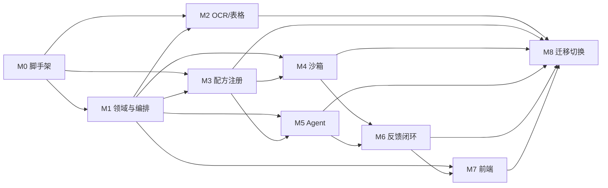

# Hanson 标准拆分平台重构整体开发计划

> 文档版本：v1.1  
> 编制日期：2026-11-11  
> 文档状态：正式开发计划（Q1–Q8 已确认）  
> 项目负责人：项目负责人（当前 1 人）  
> 上游依据：[架构重构方案](architecture-refactor-plan.md)、[项目需求文档](requirements.md)  
> 决策记录：[项目决策记录](decision-log.md)  
> 适用范围：`new_app/` 内全部前后端、算法、服务、部署、测试与迁移工作  
> 当前阶段：**仅完成计划制定与方案细化，不进行代码实现**

---

## 1. 文档体系与使用说明

### 1.1 文档层级

```text
new_app/docs/
├── architecture-refactor-plan.md        # 正式指导方案（架构唯一依据）
├── requirements.md                      # 项目需求文档（含 Q1–Q8 需求）
├── decision-log.md                      # 项目决策记录（D-001 ~ D-012）
├── development-plan.md                  # 本文件：整体总开发计划
├── M0-project-scaffold.md               # M0 详细执行计划
├── M1-core-domain-orchestration.md      # M1 详细执行计划
├── M2-ocr-table-algorithms.md           # M2 详细执行计划
├── M3-recipe-registry.md                # M3 详细执行计划
├── M4-sandbox-runtime.md                # M4 详细执行计划
├── M5-agent-runtime.md                  # M5 详细执行计划
├── M6-feedback-repair-promotion.md      # M6 详细执行计划
├── M7-frontend-core-pages.md            # M7 详细执行计划
└── M8-dictionary-comparison-cutover.md # M8 详细执行计划
```

### 1.2 使用规则

1. 架构方案是唯一架构依据；里程碑计划不得与架构方案冲突。
2. 每个里程碑开工前，由负责人确认该里程碑计划的“范围、交付物、验收标准、依赖”。
3. 里程碑计划发生变更时，必须更新本文件的“里程碑总览”和对应里程碑文档的变更记录。
4. 所有交付物必须落到 `new_app/` 内；旧代码只读参考。
5. 当前阶段只做计划，不写业务代码；M0 启动后才进入实现。

---

## 2. 项目目标与范围

### 2.1 项目目标

在 `new_app/` 中绿地重建标准拆分平台：

- 只保留标准拆分一条核心业务线。
- 采用微服务架构：网关、编排、OCR、Agent、沙箱、配方注册、审核七个服务。
- 配方/模板不可变、可版本化、可在沙箱执行、可晋升/回滚/丢弃。
- Qwen Agent Runtime 支持大窗口、上下文压缩、长任务分段、断点续跑。
- 全链路可观测、可调试、可回溯。
- 移除权限、计费、租户、工作区、用户、模块、集成、分享等非核心逻辑。

### 2.2 本期范围

| 类别 | 范围 |
|---|---|
| 前端 | 文档库、标准拆分列表、解析详情、审核、反馈、验证、时间线、版本、原文预览、词典、运行列表、配方版本 |
| 后端 | 七服务、核心领域模型、工作流、API、事件、存储 |
| 算法 | OCR/表格结构、矩阵抽取、条款抽取、Schema 投影、审核规则 |
| 模型 | Qwen Agent Runtime、Router/Review/Repair/Triage Agent |
| 沙箱 | 容器隔离、版本挂载、产物校验、资源限制 |
| 部署 | 本地 WSL K8s 验证；生产 K8s 设计；Docker Compose 开发环境；MinIO |
| 数据 | 仅导入业务词典；不默认导入旧文档/运行/产物；重构后效果对比，达标则全量重生成 |

### 2.3 本期不做

- 登录、认证、用户、角色、RBAC、API Key。
- 租户、工作区、成员、邀请、配额、计费、账单。
- 知识库、模块管理、集成任务、分享链接。
- 订单、证书、外包等非标准拆分业务线。
- 配方可视化编辑器、模板设计器。
- 旧前端逐页迁移、旧 API 兼容层。
- 旧代码直接 import 或原地改造。

---

## 3. 里程碑总览

### 3.1 里程碑清单

| 里程碑 | 名称 | 计划开始 | 计划完成 | 主要交付物 | 验收门槛 | 主责角色 | 前置依赖 |
|---|---|---|---|---|---|---|---|
| M0 | 项目启动与脚手架 | 2026-11-11 | 2026-11-18 | `new_app` 骨架、contracts、compose、WSL K8s、CI、PROVENANCE | 所有服务健康；CI 绿；无旧包 import；WSL K8s 可启动 | 项目负责人（兼架构/DevOps） | 无 |
| M1 | 核心领域与编排骨架 | 2026-11-19 | 2026-12-02 | 文档/运行/阶段/事件模型、网关、编排状态机、fake OCR/沙箱 | 上传→run→结果主链路；幂等；重启恢复；`/v1` | 项目负责人（兼后端/编排） | M0 |
| M2 | OCR 服务与表格算法 | 2026-12-03 | 2026-12-16 | OCR 服务、表格 cell graph、修复规则、表型识别、基准报告 | 表格指标不低于旧基线；确定性通过 | 项目负责人（兼算法/OCR） | M0、M1 |
| M3 | 配方/模板注册中心 | 2026-12-17 | 2026-12-30 | 配方包规范、registry、matcher、旧配方迁移 | 配方 100% 迁移；路由一致率 ≥99%；回滚可用 | 项目负责人（兼后端/配方） | M0、M1 |
| M4 | 沙箱服务与执行引擎 | 2026-12-31 | 2027-01-13 | sandbox-service、镜像、版本挂载、产物校验、运行时评分 | 运行时选型有报告；隔离/确定性/超时/OOM 全部通过 | 项目负责人（兼沙箱/平台） | M0、M1、M3 |
| M5 | Agent Runtime 与 Router/Review | 2027-01-14 | 2027-02-03 | agent-service、harness、上下文、分段、Router/Review Agent、review-service、三地址切换/窗口/看门狗报告 | 路由/审核达标；截断 0；三地址切换可验证；窗口/看门狗有基准 | 项目负责人（兼 Agent） | M0、M1、M3 |
| M6 | 反馈/修复/晋升闭环 | 2027-02-08 | 2027-02-28 | 反馈、Triage、Repair、验证包、晋升/丢弃 | 通过/拒绝两条路径 E2E；晋升原子；审计完整 | 项目负责人（兼后端/Agent） | M4、M5 |
| M7 | 前端核心页面 | 2027-03-01 | 2027-03-21 | `new_app/web` 核心页面、组件、E2E | 主链路 + 反馈闭环 E2E；视觉沿用现有风格 | 项目负责人（兼前端） | M1、M6 |
| M8 | 词典导入、效果对比与切换 | 2027-03-22 | 2027-04-11 | 词典导入脚本、效果对比报告、压测报告、切换方案、旧系统归档 | 词典对账通过；效果对比有结论；未达标已确认导入范围；SLO 达标；切换/回滚演练通过 | 项目负责人（兼数据迁移/DevOps） | M2–M7 |

> 时间节点为计划基线，节假日、资源变化、评审结论可能导致顺延；任何调整必须走“变更记录”。  
> **人力约束**：当前项目仅 1 人，原多角色并行假设不成立。实际执行按 M0→M1→M2→M3→M4→M5→M6→M7→M8 串行推进；M0 启动时必须重新基线时间表并发布 v1.2。上表日期在此之前仅作为目标参考。  
> **M0 进展（2026-11-11）**：`new_app` 脚手架已落地，旧代码已归档到 `legacy/`；待 WSL K8s、Compose 实机与远端 CI 验证后验收。详见 [M0 执行记录](M0-project-scaffold.md#13-执行记录2026-11-11)。

### 3.2 里程碑状态定义

| 状态 | 含义 |
|---|---|
| 未开始 | 计划已确认，尚未启动 |
| 进行中 | 已启动，按 WBS 推进 |
| 待验收 | 交付物完成，等待验收 |
| 已验收 | 验收标准全部满足，签字确认 |
| 阻塞 | 存在未解决的依赖/风险 |
| 已延期 | 超出计划完成日期，已登记原因 |

---

## 4. 关键路径与依赖关系



**关键路径**：M0 → M1 → M3 → M4 → M6 → M7 → M8。

**可并行**：

- M2（OCR/表格）与 M3（配方注册）可在 M1 后并行。
- M5（Agent）可在 M1、M3 后与 M4 并行。
- M7 前端可在 M1 后先做页面骨架，但反馈/验证页面必须等 M6 接口。

**依赖原则**：

- 下游里程碑不得依赖上游未验收的功能。
- 接口契约可先冻结，实现可后补；但验收必须以真实实现为准。
- 跨里程碑共享的 contracts、错误码、事件模型由架构负责人统一评审。

---

## 5. 角色与分工

### 5.1 角色定义

| 角色 | 职责 | 主要产出 |
|---|---|---|
| 项目负责人（PM） | 计划、进度、风险、跨团队协调、验收组织 | 计划、周报、验收记录、变更记录 |
| 架构负责人 | 架构方案、 contracts、服务边界、技术决策、代码评审 | ADR、contracts、架构评审意见 |
| 业务/领域专家 | 标准拆分口径、字段含义、验收样本、业务规则确认 | 业务规则说明、验收样本、问题裁决 |
| 后端负责人（编排/网关） | 网关、编排、状态机、文档/运行/反馈领域 | 服务代码、API、测试 |
| 后端负责人（配方） | 配方包、注册中心、matcher、迁移 | 注册中心、配方包、迁移报告 |
| 算法负责人（OCR/表格） | OCR 适配、表格结构、修复规则、表型识别 | OCR 服务、算法、基准报告 |
| 算法负责人（矩阵/条款/投影） | 矩阵抽取、条款抽取、Schema 投影 | 算法模块、基准报告 |
| Agent 负责人 | Qwen Agent Runtime、prompt、工具、评测 | agent-service、prompt、评测报告 |
| 沙箱/平台负责人 | sandbox-service、镜像、K8s、资源隔离 | 沙箱服务、镜像、部署清单 |
| 前端负责人 | `new_app/web` 页面、组件、交互、E2E | 前端应用、组件、E2E |
| 测试负责人（QA） | 测试策略、契约测试、集成/E2E、质量门禁 | 测试计划、测试报告、缺陷清单 |
| DevOps/SRE | CI/CD、环境、监控、备份、切换 | 流水线、环境、监控、切换方案 |
| 数据迁移/对比负责人 | 词典导入、新旧效果对比、对账、导入决策 | 词典脚本、对比报告、导入决策记录 |

### 5.2 里程碑主责

| 里程碑 | 主责 | 协作 |
|---|---|---|
| M0 | 架构负责人 | DevOps、后端、前端、QA |
| M1 | 后端负责人（编排/网关） | 架构、QA、前端 |
| M2 | 算法负责人（OCR/表格） | 架构、QA、业务专家 |
| M3 | 后端负责人（配方） | 算法、业务专家、QA |
| M4 | 沙箱/平台负责人 | 架构、DevOps、后端 |
| M5 | Agent 负责人 | 算法、QA、业务专家 |
| M6 | 后端负责人（反馈） | Agent、沙箱、QA、业务专家 |
| M7 | 前端负责人 | 后端、QA、设计/业务 |
| M8 | 项目负责人（兼数据迁移/对比） | 外部业务确认（按需） |

> **当前实际人力为 1 人**（D-012）：上表角色均由项目负责人兼任；模型服务器操作、业务确认等外部支持单独协调。每个里程碑仍保留唯一“主责角色”，用于明确责任；但执行时必须串行，不得并行开工。

---

## 6. 时间计划与假设

### 6.1 时间基线

| 里程碑 | 开始 | 完成 | 验收窗口 |
|---|---|---|---|
| M0 | 2026-11-11 | 2026-11-18 | 2026-11-18 |
| M1 | 2026-11-19 | 2026-12-02 | 2026-12-02 ~ 12-03 |
| M2 | 2026-12-03 | 2026-12-16 | 2026-12-16 ~ 12-17 |
| M3 | 2026-12-17 | 2026-12-30 | 2026-12-30 ~ 12-31 |
| M4 | 2026-12-31 | 2027-01-13 | 2027-01-13 ~ 01-14 |
| M5 | 2027-01-14 | 2027-02-03 | 2027-02-03 ~ 02-04 |
| M6 | 2027-02-08 | 2027-02-28 | 2027-02-28 ~ 03-01 |
| M7 | 2027-03-01 | 2027-03-21 | 2027-03-21 ~ 03-22 |
| M8 | 2027-03-22 | 2027-04-11 | 2027-04-11 ~ 04-12 |

> **单人排期说明**：上表为多角色并行假设下的目标基线。当前实际人力 1 人（D-012），并行假设不成立；M0 启动时重新基线并发布 v1.2 时间表。M0 之前，上表仅作为里程碑顺序与目标参考，不作为承诺日期。

### 6.2 计划假设（Q1–Q8 已确认）

1. **Q1 环境**：代码层面的 K8s 安装、配置、功能测试在本地电脑的 **WSL 环境**完成；所有模型操作在**模型服务器**执行；模型访问共三种地址（旧代码两种 + 新增 `192.168.1.35`），任一地址连续 10 秒无法连接自动切换；Qwen 固定 35B，其他模型版本参考旧代码。
2. **Q2 窗口**：在并发 4、与 GLM/Layout 共跑的负载下选择 32K/64K/128K 最优窗口；测试必须带内存看门狗，低于阈值终止进程；最终值在 M5 回填决策记录。
3. **Q3 沙箱**：M4 对 containerd/Kata/gVisor 做 PoC 与评分，选择最终运行时；当前不预锁。
4. **Q4 数据**：不默认导入旧文档/运行/产物，仅导入业务词典；重构后效果对比，达标则全部重新生成，未达标再确认导入范围。
5. **Q5 前端**：视觉完全沿用现有产品风格；不等待新设计稿。
6. **Q6 存储**：本地开发/测试统一 MinIO；生产使用 S3 兼容对象存储。
7. **Q7 API**：公开 API 保留 `/v1` 前缀。
8. **Q8 人力**：当前 1 人，串行推进；原多角色并行时间基线失效，M0 重新基线。
9. M6 跨越春节假期（2027-02-06 前后），实际排班按假期顺延。
10. 每个里程碑预留 10%–15% 缓冲，用于缺陷修复和验收整改。

---

## 7. 跨里程碑交付物总清单

### 7.1 文档

- [ ] 架构方案（已就位）
- [ ] 项目需求文档（已就位，含 Q1–Q8）
- [ ] 项目决策记录（已就位，D-001 ~ D-012）
- [ ] 整体开发计划（本文件）
- [ ] M0–M8 详细计划（各一份）
- [ ] API 契约（OpenAPI + JSON Schema）
- [ ] 数据模型说明
- [ ] 部署手册
- [ ] 运维手册
- [ ] 词典导入与效果对比手册
- [ ] 数据导入决策记录
- [ ] 验收记录

### 7.2 代码与配置

- [ ] `new_app/services/*` 七服务
- [ ] `new_app/packages/contracts`
- [ ] `new_app/packages/domain`
- [ ] `new_app/web`
- [ ] `new_app/deploy/compose`
- [ ] `new_app/deploy/k8s`
- [ ] `new_app/tests/*`
- [ ] `new_app/scripts/*`

### 7.3 质量证据

- [ ] 单元测试报告
- [ ] 契约测试报告
- [ ] 集成测试报告
- [ ] E2E 报告
- [ ] 算法基准报告
- [ ] 沙箱隔离/确定性报告
- [ ] 沙箱运行时选型评分报告
- [ ] Agent 评测报告（含窗口基准）
- [ ] 模型三地址切换测试报告
- [ ] 内存看门狗测试报告
- [ ] 性能压测报告
- [ ] 词典对账与新旧效果对比报告
- [ ] 安全扫描报告

---

## 8. 跨里程碑质量门禁

| 门禁 | 适用阶段 | 要求 | 责任人 |
|---|---|---|---|
| G0 计划门禁 | 每个里程碑开工前 | 计划、范围、交付物、验收标准、依赖已确认 | PM |
| G1 契约门禁 | M0 起 | API/事件/DTO schema 完整；破坏性变更禁止 | 架构负责人 |
| G2 代码门禁 | M1 起 | lint/typecheck/单测通过；无旧包 import | 各服务负责人 |
| G3 算法门禁 | M2 起 | 基准指标不低于旧基线；确定性通过 | 算法负责人 |
| G4 沙箱门禁 | M4 起 | 隔离/资源/产物校验通过 | 沙箱负责人 |
| G5 Agent 门禁 | M5 起 | 路由/审核指标；截断 0；断点恢复 | Agent 负责人 |
| G6 闭环门禁 | M6 起 | 通过/拒绝两条路径；晋升原子 | 后端/QA |
| G7 前端门禁 | M7 起 | 主链路/反馈闭环 E2E；无旧页面依赖 | 前端/QA |
| G8 上线门禁 | M8 | 词典对账、新旧效果对比、压测、切换/回滚演练 | PM/DevOps |

**任何门禁不通过，不得进入下一里程碑。**

---

## 9. 风险管理

| 风险 | 可能性 | 影响 | 应对 | 责任人 |
|---|---|---|---|---|
| 算法重写导致指标下降 | 中 | 高 | 基准门槛；不达标回退复制重构 | 项目负责人（兼算法） |
| 微服务拆分导致联调复杂 | 中 | 中 | contracts 先行；compose 一键环境；契约测试 | 项目负责人（兼架构） |
| 模型窗口/输出不稳定 | 中 | 高 | 真实 tokenizer；分段；schema 修复；降级 | 项目负责人（兼 Agent） |
| 沙箱运行时/节点资源不足 | 中 | 高 | M4 PoC 评分；资源预留；选定运行时后再集成 | 项目负责人 |
| 新旧效果对比未达标 | 中 | 中 | 输出差异报告；按 Q4 反馈确认导入范围；不预先全量导入 | 项目负责人 |
| 前端范围蔓延 | 中 | 中 | 只做核心页面；视觉沿用现有风格；变更评审 | 项目负责人 |
| 权限/租户逻辑回流 | 低 | 高 | 非目标清单；表结构/API 评审；CI 检查 | 项目负责人 |
| **单人人力不足/排期不可行** | 高 | 高 | 串行推进；M0 重新基线；砍并行、保门禁；外部支持提前协调 | 项目负责人 |
| 模型服务器不可用/切换失败 | 中 | 高 | 三地址 + 10 秒切换；健康探测；mock 降级；切换测试 | 项目负责人 |
| WSL K8s 资源不足 | 中 | 中 | M0 资源评估；必要时远程 Linux 验证；方案不变 | 项目负责人 |
| 模型窗口/看门狗阈值不当 | 中 | 高 | 并发 4 基准；内存看门狗；阈值标定；分阶段加压 | 项目负责人 |

---

## 10. 变更与沟通机制

### 10.1 变更流程

```text
提出变更
  → 影响分析（范围/进度/质量/依赖）
  → 项目负责人自评（涉及架构时请外部专家复核）
  → 更新本计划 + 对应里程碑文档 + 决策记录
  → 通知相关外部支持角色
```

### 10.2 会议机制

| 机制 | 频率 | 参与 | 产出 |
|---|---|---|---|
| 每日进度记录 | 每日 | 项目负责人 | 当日完成、阻塞、次日计划 |
| 里程碑自评 | 每里程碑 | 项目负责人 | 验收记录、遗留问题 |
| 架构/方案复核 | 按需 | 项目负责人 + 外部专家（按需） | ADR/评审意见 |
| 风险复盘 | 每周 | 项目负责人 | 风险清单更新 |
| 外部同步 | 按需 | 业务/模型服务器管理员 | 业务确认、模型环境支持 |

### 10.3 文档规则

- 所有计划文档版本号、日期、责任人必须完整。
- 验收记录必须附证据链接（测试报告、截图、日志）。
- 变更必须保留历史，不覆盖旧版本。

---

## 11. 已确认事项（Q1–Q8）

> 以下确认项已归档到 [项目决策记录](decision-log.md)，本表为计划执行摘要，不再作为“待确认”事项。

| 确认项 | 决策摘要 | 决策 ID | 影响里程碑 | 执行要求 |
|---|---|---|---|---|
| Q1 K8s 环境 | 代码验证用本地 **WSL** 安装/配置/测试 K8s；模型操作在模型服务器；访问共三地址（旧代码两种 + `192.168.1.35`），连续 10 秒失败自动切换；Qwen 固定 35B，其他模型参考旧代码 | D-001~D-004 | M0/M2/M4/M5/M8 | M0 做 WSL K8s PoC；M5 实现三地址切换测试 |
| Q1 模型访问 | 三地址 + 10 秒连续失败切换；防抖/回切；记录 `model.failover` | D-003 | M2/M5 | 模型网关实现；主/备/第三地址故障测试 |
| Q2 上下文窗口 | 并发 4、与 GLM/Layout 共跑，选择 32K/64K/128K 最优；默认 64K 可配 | D-005 | M5 | 三窗口基准；结果回填决策记录 |
| Q2 看门狗 | 监控模型服务器剩余内存，低于阈值主动终止测试进程 | D-006 | M5 | 阈值标定；触发日志；防止死机 |
| Q3 沙箱运行时 | containerd/Kata/gVisor 多维度 PoC 评分后选择 | D-007 | M4 | M4 K4.1 完成评分与选型 |
| Q4 旧数据 | 不默认全量导入；仅导入业务词典；重构后效果对比，达标则全量重生成，未达标再确认导入范围 | D-008 | M8 | 只建词典导入/对比脚本；全量导入后置 |
| Q5 前端视觉 | 完全沿用现有产品风格 | D-009 | M7 | 提取现有 Tokens；视觉回归 |
| Q6 对象存储 | 本地开发/测试统一 MinIO | D-010 | M0/M4/M8 | Compose 增加 MinIO；S3 兼容接口 |
| Q7 API 前缀 | 公开 API 保留 `/v1` | D-011 | M1/M7 | OpenAPI/前端统一 `/v1` |
| Q8 人力 | 当前 1 人，串行推进 | D-012 | 全阶段 | M0 重新基线时间表；不得并行/跳门禁 |

### 11.1 仍需在对应阶段验证/回填的事项

| 编号 | 事项 | 验证阶段 | 回填位置 |
|---|---|---|---|
| V-001 | WSL 内 K8s 发行版与资源清单 | M0 | decision-log D-001 |
| V-002 | Qwen 最终窗口（32K/64K/128K） | M5 | decision-log D-005 |
| V-003 | 看门狗内存阈值 | M5 | decision-log D-006 |
| V-004 | 沙箱运行时最终选型 | M4 | decision-log D-007 |
| V-005 | 新旧效果对比达标线 | M8 | decision-log D-008 |
| V-006 | 模型三地址配置项与回切策略 | M2/M5 | decision-log D-003 |
| V-007 | 生产 K8s 资源配置 | M8 | 部署文档 |
| V-008 | 单人串行时间表 | M0 | 本文件 v1.2 |

> 这些是“执行期验证项”，不是未确认的需求；处理方式已确认。

---

## 12. 里程碑计划索引

| 里程碑 | 文档 | 一句话目标 |
|---|---|---|
| M0 | [M0-project-scaffold.md](M0-project-scaffold.md) | 建好 `new_app` 骨架、契约、开发环境、CI |
| M1 | [M1-core-domain-orchestration.md](M1-core-domain-orchestration.md) | 打通上传→运行→结果的编排骨架 |
| M2 | [M2-ocr-table-algorithms.md](M2-ocr-table-algorithms.md) | OCR 服务与表格结构算法达标 |
| M3 | [M3-recipe-registry.md](M3-recipe-registry.md) | 配方包、注册中心、匹配与迁移 |
| M4 | [M4-sandbox-runtime.md](M4-sandbox-runtime.md) | 容器沙箱、版本挂载、产物校验 |
| M5 | [M5-agent-runtime.md](M5-agent-runtime.md) | Qwen Agent Runtime 与路由/审核 |
| M6 | [M6-feedback-repair-promotion.md](M6-feedback-repair-promotion.md) | 反馈→修复→验证→晋升/丢弃 |
| M7 | [M7-frontend-core-pages.md](M7-frontend-core-pages.md) | 标准拆分前端核心页面 |
| M8 | [M8-dictionary-comparison-cutover.md](M8-dictionary-comparison-cutover.md) | 词典导入、新旧效果对比、性能、切换与归档 |

---

## 13. 计划确认

| 角色 | 姓名/签字 | 确认日期 | 备注 |
|---|---|---|---|
| 项目负责人（兼架构/后端/算法/Agent/沙箱/前端/测试/DevOps/数据迁移） |  |  | 当前 1 人（D-012） |
| 业务/领域专家（外部支持） |  |  | 按需协调 |
| 模型服务器管理员（外部支持） |  |  | 按需协调 |

> 本计划经项目负责人确认后生效；业务/模型服务器外部支持在对应里程碑前确认。  
> 当前人力 1 人，所有角色由项目负责人兼任，执行按串行推进。

---

## 14. 变更记录

| 版本 | 日期 | 变更 | 变更人 |
|---|---|---|---|
| v1.0 | 2026-11-11 | 初版，建立 M0–M8 计划体系 | 项目负责人 |
| v1.1 | 2026-11-11 | 归档 Q1–Q8；更新数据策略、WSL/MinIO/`/v1`、1 人人力约束；M8 改为词典导入与效果对比 | 项目负责人 |
